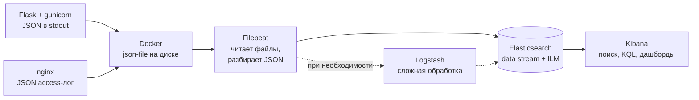

# Логи в ELK

Пользователь пишет: «в 14:03 задача не открылась». В nginx — строка с кодом 503, в приложении — трассировка `ConnectionError`, но они в разных контейнерах, а копий приложения пять. Чтобы найти все записи об одном запросе и отфильтровать их по полям «код ответа 5xx», «уровень ERROR», логи нужно собрать в одно место и разобрать на поля. Классический набор для этого — **ELK**: Elasticsearch хранит и ищет, Kibana показывает, а доставляют логи Logstash или, чаще сегодня, лёгкий агент **Filebeat**.

Общая картина централизованного логирования и более лёгкая альтернатива — Loki с Grafana — в заметке [Централизованное логирование](README.md). Чем они отличаются — [в конце](#elk-или-loki).

Стенд в [`examples/elk/`](examples/elk/) проверен на Elasticsearch и Filebeat 8.15.3, nginx 1.27.3, Python 3.12, Flask 3.1.3, gunicorn 26.2.0, python-json-logger 4.2.0 в Docker Desktop на Apple M1. Kibana 8.15.3 в стенде есть, но в проверке не запустилась из-за нехватки памяти — см. [поиск в Kibana](#поиск-в-kibana).

## Минимальный пример

nginx → сервис задач на Flask; оба пишут JSON в stdout, Filebeat читает логи контейнеров и отправляет в Elasticsearch, Kibana показывает.

```bash
cd analyze/logging/examples/elk
docker compose -p kb-elk up -d --build
curl -i localhost:48080/tasks/13
```

```text
HTTP/1.1 503 SERVICE UNAVAILABLE
X-Request-Id: 1f9c905c6d4ef94dc5482bc9b8a86a41
```

Через несколько секунд логи этого запроса из обоих сервисов можно найти по `request_id` ([`show_logs.py`](examples/elk/show_logs.py) делает `_search` и печатает главное):

```bash
python show_logs.py 1f9c905c6d4ef94dc5482bc9b8a86a41
```

```text
nginx  1f9c905c  GET /tasks/13 → 503
app    1f9c905c  ERROR   Не удалось прочитать задачу
```

Kibana — http://localhost:45601, Elasticsearch — http://localhost:49200. Остановить и удалить: `docker compose -p kb-elk down -v --rmi local`.

Стенду нужно 2 ГБ свободной памяти Docker и больше: Elasticsearch с кучей 384 МБ занимает ~850 МБ, Kibana ограничена 900 МБ, а при старте она загружает сотни плагинов. Если памяти не хватает, Elasticsearch падает с кодом 137 — его убивает OOM killer (`docker inspect kb-elk-elasticsearch-1 --format '{{.State.OOMKilled}}'` покажет `true`). Это первое, что стоит проверить, если стенд не поднимается.

## Структурированные логи в приложении

Строку `ERROR tasker: Не удалось прочитать задачу 13` человек прочитает, но искать по ней можно только по тексту. JSON-строка уже разложена на поля: уровень, логгер, id задачи, id запроса — по ним фильтруют, считают и строят графики, не разбирая текст регулярками.

```json
{"timestamp": "2026-10-29 07:41:35,548", "level": "ERROR", "logger": "tasker",
 "message": "Не удалось прочитать задачу", "request_id": "1f9c905c6d4ef94dc5482bc9b8a86a41",
 "task_id": 13, "exc_info": "Traceback (most recent call last):\n ..."}
```

В стенде это делает **python-json-logger** — форматтер для стандартного `logging` ([как устроен `logging`](../../python/extra/logging.md)). Код приложения пишет логи как обычно, а поля из `extra` попадают в JSON:

```python
logger.warning('Задача не найдена', extra={'task_id': task_id})
```

Настройка — [`app/logging_setup.py`](examples/elk/app/logging_setup.py):

```python
class RequestIdFilter(logging.Filter):
    """Добавляет request_id текущего запроса в каждую запись лога."""

    def filter(self, record: logging.LogRecord) -> bool:
        record.request_id = g.get('request_id') if has_request_context() else None
        return True


LOGGING = {
    'version': 1,
    'disable_existing_loggers': False,
    'filters': {'request_id': {'()': RequestIdFilter}},
    'formatters': {
        'json': {
            '()': 'pythonjsonlogger.json.JsonFormatter',
            'fmt': '%(asctime)s %(levelname)s %(name)s %(message)s %(request_id)s',
            'rename_fields': {'asctime': 'timestamp', 'levelname': 'level', 'name': 'logger'},
            'json_ensure_ascii': False,
        },
    },
    'handlers': {
        'stdout': {
            'class': 'logging.StreamHandler',
            'stream': 'ext://sys.stdout',
            'formatter': 'json',
            'filters': ['request_id'],
        },
    },
    'root': {'level': 'INFO', 'handlers': ['stdout']},
    'loggers': {
        # gunicorn по умолчанию пишет в свои обработчики — переводим их на общий JSON
        'gunicorn.error': {'handlers': ['stdout'], 'propagate': False, 'level': 'INFO'},
    },
}
```

Тот же словарь передан gunicorn через `logconfig_dict` в [`gunicorn.conf.py`](examples/elk/gunicorn.conf.py), поэтому и служебные строки сервера (`Booting worker with pid: 7`) уходят в JSON. Логи пишутся в stdout: в контейнере не нужно управлять файлами, их соберёт Docker.

**`request_id`** связывает все записи одного запроса. nginx генерирует его (`$request_id`) и передаёт приложению заголовком `X-Request-Id`; приложение кладёт его в `g` в `before_request`, фильтр добавляет в каждую запись, а ответ возвращает тот же заголовок клиенту — по нему пользователь или поддержка находят свой запрос. Если запрос пришёл в обход nginx, приложение генерирует id само. В связке с трассировкой вместо своего id пишут `trace_id` — см. [распределённую трассировку](../tracing/README.md).

### Альтернатива: structlog

**structlog** изначально построен вокруг структурных логов: поля передаются аргументами, а контекст запроса привязывается через `contextvars`:

```python
import structlog

structlog.configure(
    processors=[
        structlog.contextvars.merge_contextvars,  # поля, привязанные к запросу
        structlog.processors.add_log_level,
        structlog.processors.TimeStamper(fmt='iso', utc=True),
        structlog.processors.JSONRenderer(ensure_ascii=False),
    ],
)
logger = structlog.get_logger('tasker')

structlog.contextvars.bind_contextvars(request_id='6c6f27ff3b2fa4a3')  # в middleware в начале запроса
logger.warning('Задача не найдена', task_id=99)
```

```text
{"task_id": 99, "event": "Задача не найдена", "request_id": "6c6f27ff3b2fa4a3", "level": "warning", "timestamp": "2026-10-29T07:30:02.632130Z"}
```

python-json-logger проще встроить в существующий проект — меняется только форматтер. structlog удобнее в новом коде, но логи сторонних библиотек через стандартный `logging` нужно отдельно направить в его форматирование.

## nginx в JSON

Стандартный формат access-лога nginx (`combined`) — строка, которую потом разбирают регулярным выражением. Проще сразу писать JSON — [`nginx.conf`](examples/elk/nginx.conf):

```nginx
log_format json_combined escape=json
  '{'
    '"time":"$time_iso8601",'
    '"remote_addr":"$remote_addr",'
    '"request_id":"$request_id",'
    '"method":"$request_method",'
    '"uri":"$request_uri",'
    '"status":$status,'
    '"body_bytes_sent":$body_bytes_sent,'
    '"request_time":$request_time,'
    '"upstream_response_time":"$upstream_response_time",'
    '"http_user_agent":"$http_user_agent"'
  '}';

server {
    listen 80;
    access_log /dev/stdout json_combined;

    location / {
        proxy_pass http://app:8000;
        proxy_set_header Host $host;
        proxy_set_header X-Request-Id $request_id;
    }
}
```

- `escape=json` экранирует кавычки и спецсимволы в значениях: без него `User-Agent` с кавычкой сломает JSON.
- `$status`, `$body_bytes_sent`, `$request_time` — без кавычек, чтобы попасть в Elasticsearch числами: тогда работают `status >= 500` и средние.
- `$upstream_response_time` — в кавычках: если до приложения не дошли, nginx пишет `-`, и без кавычек JSON станет невалидным.
- Ключ назван `http_user_agent`, а не `user_agent`: в схеме полей Elastic (ECS) `user_agent` — объект, и строка в этом поле не индексируется (подробнее ниже).

Получилось:

```json
{"time":"2026-10-29T07:41:35+00:00","remote_addr":"192.168.65.1","request_id":"1f9c905c6d4ef94dc5482bc9b8a86a41","method":"GET","uri":"/tasks/13","status":503,"body_bytes_sent":237,"request_time":0.003,"upstream_response_time":"0.003","http_user_agent":"curl/8.7.1"}
```

## Путь лога: от stdout до Kibana



**Filebeat** — лёгкий агент на Go (в стенде ~100 МБ памяти): читает файлы, помнит, до какого места дочитал (реестр), и отправляет пачками. В стенде он через Docker API находит контейнеры (autodiscover), читает их файлы логов и раскладывает JSON по полям — [`filebeat.yml`](examples/elk/filebeat.yml):

```yaml
filebeat.autodiscover:
  providers:
    - type: docker
      templates:
        # Только app и nginx этого проекта, а не всё, что запущено в Docker
        - condition:
            regexp:
              docker.container.name: "^kb-elk-(app|nginx)-"
          config:
            - type: filestream
              id: container-${data.docker.container.id}
              paths:
                - /var/lib/docker/containers/${data.docker.container.id}/*.log
              parsers:
                - container: ~
              fields:
                # service — объект в схеме ECS, поэтому имя кладём в service.name, а не в service
                service.name: ${data.docker.container.labels.com.docker.compose.service}
              fields_under_root: true

processors:
  # Строка лога — JSON: раскладываем её поля в корень документа
  - decode_json_fields:
      fields: ["message"]
      target: ""
      overwrite_keys: true
      add_error_key: true

output.elasticsearch:
  hosts: ["http://elasticsearch:9200"]

setup.ilm.policy_name: logs-7d
setup.ilm.policy_file: /usr/share/filebeat/ilm-policy.json
setup.ilm.overwrite: true
```

- Парсер `container` снимает обёртку Docker (`{"log": "...", "stream": "stdout", "time": ...}`), остаётся строка приложения.
- `decode_json_fields` превращает её в поля документа. Строка, которая не JSON (например, `[notice]` из error-лога nginx), не теряется: остаётся в `message`, а в `error.message` — причина `parsing input as JSON`.
- Контейнеру Filebeat нужны `/var/lib/docker/containers` (файлы логов) и `docker.sock` (имена и метки контейнеров), а также права root.

Три вещи, на которых стенд не заработал с первого раза:

1. **Docker Desktop по умолчанию пишет логи драйвером `local`** — в двоичном формате, который Filebeat не читает. В папке контейнера не было ни одного `*-json.log`, Filebeat молчал, документов не было. Решение — явно `logging: driver: json-file` у сервисов в compose (с `max-size`, иначе файл растёт бесконечно). Проверить драйвер: `docker inspect <контейнер> --format '{{.HostConfig.LogConfig.Type}}'`.
2. **Условие по меткам compose не сработало.** Метки вида `com.docker.compose.project` в событии autodiscover приходят вложенным объектом, причём `project` одновременно и значение, и родитель `project.config_files`. Условие `equals` по метке проекта не совпало ни с одним контейнером; условие `regexp` по имени контейнера работает.
3. **Конфликт с полями ECS.** Filebeat загружает шаблон индекса со схемой Elastic Common Schema, где `service`, `user_agent`, `log`, `host`, `agent`, `error` — объекты. Документ, где такое поле — строка, Elasticsearch отклоняет с `400 document_parsing_exception: object mapping for [user_agent] tried to parse field [user_agent] as object, but found a concrete value`, и Filebeat его **выбрасывает** — в Kibana такой строки просто нет. Причина видна только в логе Filebeat (`Cannot index event ... dropping event!`). Поэтому свои ключи не должны совпадать с объектами ECS: `service.name`, `http_user_agent`.

### Когда нужен Logstash

**Logstash** — отдельный сервис обработки на JVM: входы → фильтры → выходы. Он нужен, когда обработка сложнее, чем умеет агент:

- логи не в JSON и их надо разбирать шаблонами `grok` (старые приложения, сетевое оборудование);
- обогащение: геоданные по IP, справочники, переименование полей под общую схему из десятков источников;
- маршрутизация: часть логов в Elasticsearch, часть в S3 или Kafka; разные индексы для разных команд;
- буфер между агентами и Elasticsearch с постоянной очередью на диске.

Если приложения пишут JSON, а обработка сводится к разбору JSON и добавлению меток, Filebeat пишет в Elasticsearch напрямую: на один тяжёлый сервис меньше. Промежуточный вариант — **ingest pipeline** в самом Elasticsearch: те же `grok`, `rename`, `date`, но выполняются при индексации. Пример конвейера Logstash для того же потока (в стенде не запускался):

```text
input  { beats { port => 5044 } }
filter {
  json { source => "message" skip_on_invalid_json => true }
  if [status] and [status] >= 500 { mutate { add_tag => ["server_error"] } }
}
output { elasticsearch { hosts => ["http://elasticsearch:9200"] data_stream => "true" } }
```

Filebeat тогда пишет в `output.logstash: hosts: ["logstash:5044"]`.

## Что получилось в Elasticsearch

Документы двух сервисов для одного запроса (служебные поля Filebeat — `agent`, `host`, `log`, `docker` — убраны):

```bash
curl -s 'localhost:49200/filebeat-*/_search' -H 'Content-Type: application/json' -d '{
  "query": {"term": {"request_id": "1f9c905c6d4ef94dc5482bc9b8a86a41"}},
  "sort": [{"@timestamp": "asc"}]
}'
```

```json
{
  "@timestamp": "2026-10-29T07:41:35.550Z",
  "service": {"name": "app"},
  "container": {"name": "kb-elk-app-1"},
  "level": "ERROR",
  "logger": "tasker",
  "message": "Не удалось прочитать задачу",
  "request_id": "1f9c905c6d4ef94dc5482bc9b8a86a41",
  "task_id": 13,
  "exc_info": "Traceback (most recent call last):\n  File \"/srv/app/main.py\", line 38, in get_task\n    raise ConnectionError('база не отвечает')\nConnectionError: база не отвечает",
  "timestamp": "2026-10-29 07:41:35,548",
  "stream": "stdout"
}
{
  "@timestamp": "2026-10-29T07:41:35.550Z",
  "service": {"name": "nginx"},
  "container": {"name": "kb-elk-nginx-1"},
  "request_id": "1f9c905c6d4ef94dc5482bc9b8a86a41",
  "method": "GET",
  "uri": "/tasks/13",
  "status": 503,
  "request_time": 0.003,
  "upstream_response_time": "0.003",
  "body_bytes_sent": 237,
  "remote_addr": "192.168.65.1",
  "http_user_agent": "curl/8.7.1",
  "time": "2026-10-29T07:41:35+00:00",
  "message": "{\"time\":\"2026-10-29T07:41:35+00:00\", ... }",
  "stream": "stdout"
}
```

Типы полей Elasticsearch определил сам (запрос `GET filebeat-*/_mapping/field/...`):

```text
status        long        request_time  float      task_id  long
request_id    keyword     level         keyword    uri      keyword
service.name  keyword     message       match_only_text
```

Числа стали числами — по `status` работают диапазоны. Строки шаблон Filebeat делает `keyword`: поиск по точному значению и агрегации, но не полнотекстовый. Полнотекстовый поиск идёт по `message`.

Пара деталей: у nginx в JSON нет ключа `message`, поэтому исходная строка осталась в `message` целиком — место занимает дважды (её можно убрать процессором `drop_fields`). `@timestamp` — время, когда Docker принял строку, а не поле `timestamp` из лога; чтобы использовать время из самого лога, добавляют процессор `timestamp`.

## Индексы, data streams и ILM

Логи только дописываются и почти никогда не меняются, а нужны в основном за последние дни. Поэтому их пишут не в один огромный индекс, а в **data stream** — поток, за которым стоит цепочка скрытых индексов. Запись всегда идёт в последний, а старые целиком удаляются — это дёшево, в отличие от удаления документов по одному.

- **Шаблон индекса** (index template) задаёт для всех индексов потока маппинг и настройки. Filebeat загружает свой шаблон `filebeat-8.15.3` при старте.
- **ILM** (index lifecycle management) — политика жизни индексов: когда начинать новый (rollover) и когда удалять.

Своя политика в стенде — [`ilm-policy.json`](examples/elk/ilm-policy.json): новый индекс каждый день или при 10 ГБ на шард, удаление через 7 дней после rollover.

```json
{
  "policy": {
    "phases": {
      "hot": {"actions": {"rollover": {"max_age": "1d", "max_primary_shard_size": "10gb"}}},
      "delete": {"min_age": "7d", "actions": {"delete": {}}}
    }
  }
}
```

Проверка, что Filebeat её применил:

```bash
curl -s localhost:49200/_data_stream/filebeat-8.15.3
curl -s 'localhost:49200/.ds-filebeat-*/_ilm/explain'
```

```text
filebeat-8.15.3  индексы: ['.ds-filebeat-8.15.3-2026.10.29-000001']  ilm_policy: logs-7d
.ds-filebeat-8.15.3-2026.10.29-000001  policy: logs-7d  phase: hot  action: rollover
```

Срок хранения выбирают от задач: разбор инцидентов — 7–30 дней; аудит и требования закона — дольше, но тогда старые индексы переводят на дешёвые узлы (фазы `warm` и `cold`) или в снимки (snapshot) в S3.

## Поиск в Kibana

Чтобы искать в Kibana, нужен **data view** (раньше — index pattern): Stack Management → Data Views → `filebeat-*`, поле времени `@timestamp`. Затем Discover — список документов с фильтрами и строкой запроса на **KQL** (Kibana Query Language):

```text
request_id : "1f9c905c6d4ef94dc5482bc9b8a86a41"           все записи одного запроса
service.name : "nginx" and status >= 500                  ошибки сервера на входе
service.name : "app" and level : ("ERROR" or "WARNING")   проблемы в приложении
level : "ERROR" and not logger : "gunicorn.error"         ошибки кода, без сервера
message : *задачу*                                        поиск по тексту сообщения
```

KQL: `поле : значение`, `and` / `or` / `not`, скобки, сравнения `>=` для чисел и дат, `*` — подстановка. Кроме Discover в Kibana строят дашборды (число 5xx по минутам, топ медленных URL по `request_time`) и правила оповещений.

Запросы KQL выше не проверены в стенде: Kibana 8.15.3 с Elasticsearch одновременно не уместились в память Docker (около 4 ГБ, занятых и другими проектами) — при запуске Kibana Elasticsearch каждый раз убивал OOM killer. Сбор, разбор полей и ILM проверены через API Elasticsearch, как показано выше.

## Частые ошибки

- **Логи текстом, а не JSON.** Потом приходится писать `grok`-шаблоны и чинить их при каждом изменении формата.
- **Нет `request_id`.** Записи nginx и приложения об одном запросе не связать.
- **Поля, совпадающие с объектами ECS** (`service`, `user_agent`, `host`, `error`). Документы молча выбрасываются с ошибкой 400 — проверяйте лог Filebeat на `dropping event`.
- **Разные типы одного поля в разных сервисах.** `status` числом в nginx и строкой `"OK"` в приложении — второй документ отклонят. Договоритесь о схеме полей заранее.
- **Без ILM.** Диск Elasticsearch заполняется, кластер переводит индексы в режим только для чтения, и новые логи перестают приниматься.
- **Персональные данные и секреты в логах.** Из Elasticsearch их увидят все, у кого есть доступ к Kibana. Маскирование — в заметке [Персональные данные](../../web/security/personal_data.md#маскирование-в-логах).
- **`xpack.security.enabled: false` за пределами ноутбука.** В стенде безопасность выключена для простоты; в реальном кластере нужны пароли и TLS.

## ELK или Loki

ELK индексирует содержимое логов: быстрый полнотекстовый поиск и агрегации по любым полям, но кластеру Elasticsearch нужно много памяти и диска, и его сложнее эксплуатировать — в проверке Elasticsearch и Kibana этого маленького стенда не уместились вместе в ~4 ГБ памяти Docker, занятой и другими проектами. Loki индексирует только метки, а текст хранит сжатым: намного дешевле, но поиск по содержимому — перебором внутри выбранных потоков. Подробно — в заметке [Централизованное логирование](README.md#elk-как-альтернатива). Ошибки с группировкой и контекстом удобнее смотреть не в логах, а в [Sentry](../sentry/README.md).

## Связанные темы

- [Централизованное логирование: Loki](README.md)
- [Логирование в Python](../../python/extra/logging.md)
- [Sentry](../sentry/README.md)
- [Распределённая трассировка](../tracing/README.md)
- [Полнотекстовый поиск в Elasticsearch](../../data/elasticsearch/docs/search.md)
- [Flask](../../framework/flask/README.md)
- [nginx](../../web/nginx/README.md)
