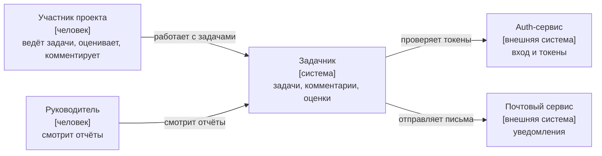
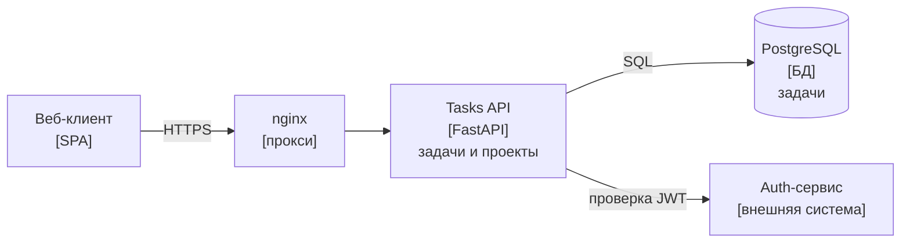
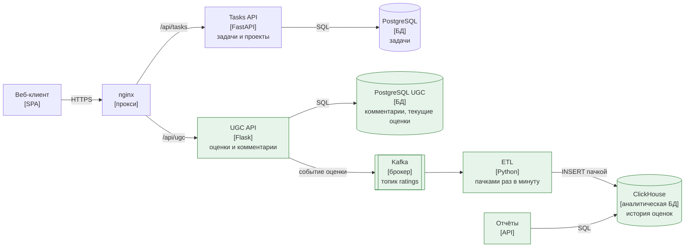
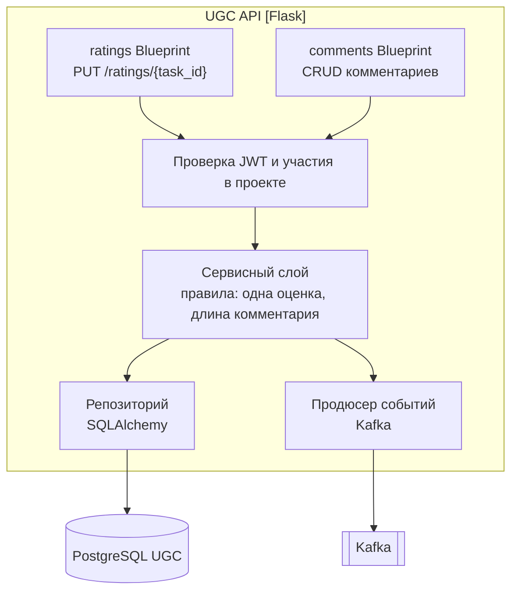

# От требований к архитектуре

Задача приходит фразой из бизнеса: «Хотим, чтобы пользователи могли комментировать и оценивать задачи». Из неё нельзя сразу выбрать базу и нарисовать схему: непонятно, сколько будет оценок, можно ли менять оценку, что показывать на странице задачи и что будет, если сервис оценок упадёт. Путь от фразы к архитектуре — это цепочка: требования → цифры нагрузки → схема → записанные решения. Пропустите звено — и архитектура окажется либо слишком простой, либо из пяти хранилищ там, где хватило бы одного.

Сквозной пример заметки — добавить в [«Задачник»](../../pet/tasker/README.md) комментарии и оценки задач.

## Минимальный пример

Одна фраза бизнеса и то, во что она превращается:

```text
«Пусть пользователи ставят задачам оценку от 1 до 5»

Функциональное:    как исполнитель я хочу оценить сложность задачи от 1 до 5,
                   чтобы руководитель видел, какие задачи были тяжёлыми
Критерий приёмки:  повторная оценка той же задачи заменяет прежнюю, а не добавляет вторую
Нефункциональное:  POST оценки отвечает за 200 мс в 99% случаев при пике 60 запросов в секунду
Цифры:             200 тыс. активных в день × 5 оценок = 1 млн в день ≈ 12 RPS, пик ≈ 60 RPS
Решение (ADR):     текущая оценка — в PostgreSQL, история событий — в ClickHouse
```

Дальше разберём каждую строку.

## Функциональные требования

Функциональные требования отвечают на вопрос **что** система делает. Их удобно записывать в трёх формах — от крупной к мелкой.

**Сценарий использования** (use case) — последовательность шагов пользователя и системы для достижения цели:

```text
Сценарий: оставить комментарий к задаче
1. Пользователь открывает задачу и пишет текст комментария.
2. Система проверяет, что пользователь — участник проекта.
3. Система сохраняет комментарий и показывает его в ленте задачи.
4. Автор задачи получает уведомление.
Альтернатива 2а: пользователь не участник проекта → 403, комментарий не сохранён.
```

**Пользовательская история** (user story) — короткая формула «как <роль> я хочу <действие>, чтобы <ценность>»:

- как исполнитель я хочу оставить комментарий к задаче, чтобы уточнить условие у автора;
- как автор задачи я хочу получать уведомление о новом комментарии, чтобы быстро ответить;
- как руководитель я хочу видеть среднюю оценку сложности задач за месяц, чтобы планировать загрузку команды.

Часть «чтобы» важнее, чем кажется: она объясняет цель, и по ней видно, что третья история — про аналитику, а не про страницу задачи. Это сразу подсказывает отдельное хранилище для отчётов.

**Критерии приёмки** (acceptance criteria) — проверяемые условия, при которых история считается сделанной. Удобный формат — «Дано / Когда / Тогда» (Given / When / Then), его потом легко превратить в тест:

```text
Дано:  пользователь уже поставил задаче 1 оценку 3
Когда: он ставит той же задаче оценку 5
Тогда: у задачи одна оценка от этого пользователя — 5, средняя пересчитана
```

```text
Дано:  комментарий длиннее 5 000 символов
Когда: пользователь его отправляет
Тогда: 422 с понятной ошибкой, комментарий не сохранён
```

## Нефункциональные требования

Нефункциональные требования отвечают на вопрос **как хорошо** система это делает. Именно они определяют архитектуру: одну и ту же функцию «сохранить оценку» можно сделать одной таблицей или кластером, и выбор зависит от цифр, а не от функции.

| Категория | Вопрос | Пример формулировки |
|---|---|---|
| Производительность | Как быстро? | p99 ответа `POST /ratings` — не больше 200 мс |
| Пропускная способность | Сколько? | 60 оценок в секунду в пик, 300 чтений комментариев в секунду |
| Доступность | Как часто можно лежать? | 99,9% успешных запросов за 30 дней |
| Масштаб и рост | Сколько данных и как быстро растёт? | 365 млн событий оценок в год, рост вдвое за год |
| Согласованность | Можно ли видеть старое? | средняя оценка может отставать до минуты |
| Безопасность | Кто что видит? | комментарии видят только участники проекта; текст комментариев не попадает в логи |
| Наблюдаемость | Как узнаем о проблеме? | метрики задержки и ошибок, алерт при 1% ошибок за 5 минут, ошибки — в [Sentry](../../analyze/sentry/README.md) |
| Сопровождаемость | Кто и как будет поддерживать? | команда из трёх Python-разработчиков, деплой без простоя |

Главное правило: требование должно быть **измеримым**. «Сервис должен быть быстрым» — пожелание. «p99 не больше 200 мс при 60 RPS» — требование: его можно проверить нагрузочным тестом и мониторингом.

## Как выявлять требования

Бизнес редко приносит готовые требования — он приносит идею. Работа разработчика — задать вопросы, ответы на которые меняют архитектуру. Разберём «добавить в Задачник комментарии и оценки задач».

**Кто и что делает:**

- Кто может оценивать и комментировать: любой пользователь, участник проекта, только исполнитель?
- Оценка — чего именно: сложности, качества постановки, «понравилось»? Шкала 1–5 или «лайк»?
- Можно ли менять и удалять оценку и комментарий? Если удалять — физически или помечать?
- Нужны ли ответы на комментарии (дерево), упоминания `@user`, вложения?
- Нужна ли модерация? Кто её делает?

**Что и где показываем:**

- Что видно на странице задачи: средняя оценка, количество, моя оценка, последние 20 комментариев?
- Какие отчёты нужны: средняя оценка по проекту за месяц, распределение оценок, самые обсуждаемые задачи? Насколько свежими они должны быть — секунды или сутки?

**Сколько:**

- Сколько пользователей всего и активных в день? Как распределена нагрузка по часам?
- Сколько оценок и комментариев ожидается на пользователя? Сколько хранить — год, вечно?

**Что если:**

- Что важнее при сбое: принять оценку (пусть отчёт обновится позже) или показать точное среднее?
- Можно ли потерять оценку? А комментарий? (Обычно комментарий терять нельзя, а одно событие для аналитики — допустимо.)
- Есть ли требования закона: комментарии могут содержать [персональные данные](../../web/security/personal_data.md), их надо уметь удалить по запросу.

**Ответы, которые получили** (они дальше используются в расчётах):

- оценка сложности 1–5, ставит любой участник проекта, менять можно, одна оценка на пользователя и задачу;
- комментарии плоские, без вложений, автор может редактировать и удалять;
- на странице задачи — средняя оценка, количество, моя оценка и последние комментарии;
- руководителю нужны отчёты по оценкам за произвольный период, отставание до часа допустимо;
- 1 млн пользователей в месяц, 200 тыс. в день, пик вечером в 5 раз выше среднего;
- потерять одно событие для отчёта не страшно, а сам комментарий — нельзя.

## Метрики

### Перцентили: почему не среднее

Задержку описывают **перцентилями**. p95 = 156 мс означает: 95% запросов уложились в 156 мс, а 5% были медленнее. p50 — медиана, «обычный» запрос. p99 — почти худший случай, который видит каждый сотый пользователь.

Среднее для задержки вредно: несколько очень медленных запросов сдвигают его, и оно не описывает ни быстрых, ни медленных. Проверим на сгенерированных задержках с длинным хвостом: 95% запросов быстрые, 4% — промах кэша, 1% — ожидание таймаута соседнего сервиса.

```python
import random
import statistics

random.seed(42)

latencies = (
    [random.gauss(40, 8) for _ in range(9_500)]
    + [random.gauss(300, 50) for _ in range(400)]
    + [random.uniform(1_000, 3_000) for _ in range(100)]
)

cuts = statistics.quantiles(latencies, n=100)  # 99 границ: cuts[49] — p50, cuts[94] — p95
print(f'среднее {statistics.mean(latencies):7.1f} мс')
print(f'p50     {cuts[49]:7.1f} мс')
print(f'p95     {cuts[94]:7.1f} мс')
print(f'p99     {cuts[98]:7.1f} мс')
print(f'max     {max(latencies):7.1f} мс')

slower_than_mean = sum(1 for value in latencies if value > statistics.mean(latencies))
print(f'медленнее среднего: {slower_than_mean / len(latencies):.1%} запросов')
```

```text
среднее    69.8 мс
p50        40.4 мс
p95       156.7 мс
p99      1054.0 мс
max      2977.7 мс
медленнее среднего: 5.0% запросов
```

Среднее 70 мс выглядит хорошо, но такого запроса почти нет: обычный выполняется за 40 мс, а каждый сотый — больше секунды. По среднему хвост не увидеть, а именно его замечают пользователи.

Хвост важнее, чем кажется, когда одна страница делает несколько запросов. Если страница задачи вызывает 10 сервисов, вероятность, что хотя бы один ответит хуже своего p99, — `1 − 0,99¹⁰ ≈ 9,6%`. Для каждого десятого открытия страницы p99 отдельного сервиса становится обычной задержкой.

Перцентили считают по гистограмме за окно времени, например в [Prometheus](../../analyze/prometheus/README.md) через `histogram_quantile`. Перцентили нельзя усреднять между серверами: среднее из p99 двух серверов — не p99 общего потока. Складывать надо гистограммы.

### DAU, MAU и активность

- **DAU** (daily active users) — уникальные пользователи за день, **MAU** (monthly active users) — за месяц.
- **DAU/MAU** — «липкость»: какая доля месячной аудитории заходит каждый день. 20% — пользователь в среднем приходит раз в пять дней; для рабочего инструмента вроде Задачника реально и 50%.

Для оценки нагрузки нужен DAU: нагрузку создают те, кто пришёл сегодня, а не все зарегистрированные.

### RPS, RPM и пик

- **RPS** (requests per second) — запросов в секунду, **RPM** — в минуту. Для API обычно говорят в RPS, для редких операций — в RPM или в день.
- Средний RPS = запросов в день / 86 400. Но нагрузка неравномерна: днём и вечером её больше, ночью почти нет.
- **Пиковая нагрузка** = средняя × коэффициент. Без данных берут 2–10; для рабочих сервисов с пиком в рабочие часы — около 3–5. Систему рассчитывают на пик, а не на среднее, и с запасом.

## Оценка нагрузки на салфетке

Оценка «на салфетке» (back-of-the-envelope) — грубый расчёт порядка величин. Точность не нужна: важно, будет ли это 10 RPS или 10 000, 30 ГБ или 30 ТБ. Шаги всегда одни: пользователи → действия → RPS → пик → объём данных.

```python
SECONDS_PER_DAY = 86_400
PEAK_FACTOR = 5

mau = 1_000_000
dau = 200_000
actions = {  # действий на активного пользователя в день, байт на запись
    'просмотр комментариев': (20, None),
    'оценка задачи': (5, 100),
    'новый комментарий': (1, 500),
}

for name, (per_user, size) in actions.items():
    per_day = dau * per_user
    rps = per_day / SECONDS_PER_DAY
    line = f'{name:24} {per_day:>10,} в день  {rps:6.1f} RPS  пик {rps * PEAK_FACTOR:6.1f}'
    if size:
        line += f'  {per_day * 365 * size / 1e9:5.1f} ГБ в год'
    print(line)
```

```text
просмотр комментариев     4,000,000 в день    46.3 RPS  пик  231.5
оценка задачи             1,000,000 в день    11.6 RPS  пик   57.9   36.5 ГБ в год
новый комментарий           200,000 в день     2.3 RPS  пик   11.6   36.5 ГБ в год
```

Откуда байты: событие оценки — id пользователя и задачи, оценка, время и служебные поля, около 100 байт; комментарий — в среднем 300–500 байт текста плюс метаданные.

Выводы:

- **нагрузка небольшая.** 60 записей и 230 чтений в секунду в пик выдержит одна база PostgreSQL. Шардирование, кэш на каждый запрос и пять реплик здесь не нужны;
- **чтений больше, чем записей**, примерно в 20 раз. Если страница задачи станет горячей, первым кандидатом будет [кэш](caching.md) ленты комментариев;
- **объём растёт линейно и предсказуемо**: 365 млн событий оценок в год. Хранить их можно где угодно, но отчёты «средняя оценка по проекту за квартал» по сотням миллионов строк в PostgreSQL будут идти секунды и минуты. Это аргумент за отдельное аналитическое хранилище — см. ADR ниже.

## SLI, SLO и SLA

Три слова про одно — надёжность, но с разных сторон:

- **SLI** (service level indicator) — что измеряем. Доля успешных запросов: `ответы не 5xx / все ответы`. Доля быстрых: `ответы быстрее 200 мс / все ответы`.
- **SLO** (service level objective) — цель для SLI, внутренняя договорённость команды: «99,9% запросов к `POST /ratings` успешны за скользящие 30 дней».
- **SLA** (service level agreement) — обещание клиенту с последствиями: «доступность 99,5% в месяц, иначе компенсация». SLA всегда мягче SLO, чтобы у команды был запас.

Что значат «девятки» за 30 дней:

| Цель | Можно лежать в месяц | В год |
|---|---|---|
| 99% | 7,2 часа | 3,65 дня |
| 99,9% | 43 минуты | 8,8 часа |
| 99,95% | 22 минуты | 4,4 часа |
| 99,99% | 4,3 минуты | 53 минуты |

Разница между 100% и SLO — **бюджет ошибок** (error budget). Пока он не исчерпан, можно выпускать новое и рисковать. Когда исчерпан — команда занимается надёжностью, а не фичами. 100% не ставят никогда: каждая девятка стоит кратно дороже, а пользователь не отличит 99,99% от 100% из-за собственного Wi-Fi.

## Описание архитектуры

Схема «квадратики и стрелки» без правил у каждого своя: где-то квадрат — сервис, где-то — сервер, где-то — команда. Модель **C4** договаривается о четырёх уровнях масштаба, как карта: страна → город → улица → дом. Обычно рисуют первые три, четвёртый (код) — редко.

GitHub и большинство редакторов отображают диаграммы [Mermaid](https://mermaid.js.org/) прямо в Markdown, поэтому схемы удобно хранить рядом с кодом и править в pull request. В Mermaid есть экспериментальный синтаксис `C4Context`, но обычный `flowchart` отображается надёжнее, поэтому ниже C4 нарисована им: в подписи блока — имя, тип в квадратных скобках и назначение.

### Уровень 1: контекст

Система целиком — один блок. Вокруг — люди и внешние системы. Схема для всех, включая бизнес: что мы строим и с чем оно связано.



### Уровень 2: контейнеры

Контейнер в C4 — не Docker-контейнер, а отдельно запускаемая часть: приложение, база, брокер. Схема для разработчиков и эксплуатации: какие процессы, чем общаются, где хранятся данные.

**AS-IS** — как система устроена сейчас:



**TO-BE** — какой она станет после изменения. Новое выделено:



Пара AS-IS / TO-BE полезна на ревью: сразу видно, что меняется, а что нет. Здесь Tasks API не трогаем совсем — новые функции живут в отдельном сервисе, и его падение не ломает работу с задачами.

### Уровень 3: компоненты

Один контейнер изнутри: основные модули и их ответственность. Схема для команды, которая этот сервис пишет.



Как устроены слои внутри сервиса — в заметке [Архитектура приложения](architecture.md).

## Выбор технологий

Для каждого нового блока на схеме выбирают технологию. Критерии в порядке, в котором они обычно решают:

1. **Подходит ли под требования.** Нагрузка, модель данных, согласованность. Для потока событий с аналитикой — колоночная база, для комментариев с правкой и удалением — строковая.
2. **Знает ли команда.** Инструмент, который никто не умеет готовить, обойдётся дороже, чем кажется: ошибки в настройке, ночные дежурства, поиск людей.
3. **Цена эксплуатации.** Кто будет обновлять, бэкапить, мониторить. Управляемый сервис в облаке против своего кластера.
4. **Зрелость и сообщество.** Документация, ответы на типовые вопросы, драйверы для Python, история выпусков.
5. **Лицензия и стоимость.**
6. **Обратимость.** Насколько дорого будет отказаться через два года.

Принцип **«скучных технологий»** (choose boring technology): у команды есть всего несколько «жетонов на новизну». Каждая новая база или брокер — это жетон: нужно научиться её эксплуатировать и понять, как она ломается. Тратить жетоны стоит там, где без новой технологии требования не выполнить. Остальное делаем на том, что уже работает в продакшене и хорошо понятно.

В примере так и выходит: комментарии и текущие оценки — в уже знакомом PostgreSQL, а новую технологию (ClickHouse) берём только для отчётов по истории, где PostgreSQL объективно неудобен.

## ADR: записываем решения

Через год кто-то спросит: «Почему оценки в ClickHouse? Можно же было в PostgreSQL». Если ответ остался в голове уволившегося архитектора или в чате, решение либо повторят, потратив неделю, либо отменят, наступив на те же грабли.

**ADR** (architecture decision record) — короткий документ об одном архитектурном решении: почему приняли, что рассматривали и чем заплатили. ADR хранят в репозитории рядом с кодом (`docs/adr/0001-ratings-in-clickhouse.md`), нумеруют по порядку и не переписывают: если решение изменилось, пишут новый ADR со статусом «заменяет 0001», а старому ставят «заменён 0007».

Шаблон:

```markdown
# 0001. Короткое название решения

Статус: предложено | принято | отклонено | заменено ADR-NNNN
Дата: ГГГГ-ММ-ДД

## Контекст
Какая проблема, какие требования и ограничения. Цифры из оценки нагрузки.

## Решение
Что решили — одним-двумя абзацами, в утвердительной форме.

## Рассмотренные альтернативы
Что ещё рассматривали и почему не выбрали.

## Последствия
Что станет проще, что сложнее, какие риски и что придётся сделать.
```

Пример:

```markdown
# 0003. События оценок храним в ClickHouse, текущую оценку — в PostgreSQL

Статус: принято
Дата: 2026-10-29

## Контекст
Пользователи ставят задачам оценку сложности 1–5 и могут её менять.
Ожидается 1 млн оценок в день (пик ~60 в секунду), 365 млн событий в год,
около 36 ГБ в год без сжатия. Руководителям нужны отчёты по истории оценок
за произвольный период в разрезе проектов и команд; отставание до часа допустимо.
Странице задачи нужны средняя оценка, количество и оценка текущего пользователя.

## Решение
Текущая оценка пользователя хранится в PostgreSQL сервиса UGC
(таблица ratings, первичный ключ user_id + task_id, запись через upsert).
Каждое изменение оценки публикуется событием в Kafka, ETL пачками раз в минуту
пишет события в ClickHouse (MergeTree, партиции по месяцу). Отчёты строятся
только по ClickHouse.

## Рассмотренные альтернативы
- Всё в PostgreSQL, отчёты по таблице событий. По записи справится,
  но агрегаты по сотням миллионов строк займут секунды и минуты и будут
  конкурировать за ресурсы с запросами страницы задачи. Партицирование
  и материализованные представления помогут, но это ручная работа
  на каждый новый отчёт.
- Реплика PostgreSQL для отчётов. Снимает нагрузку с основной базы,
  но не ускоряет сами агрегаты по строковому хранению.
- Писать события прямо в ClickHouse из API, без Kafka. Проще,
  но ClickHouse плохо переносит частые одиночные вставки, а при его
  недоступности API начнёт отвечать ошибками.

## Последствия
+ Отчёты по истории — доли секунды на сотнях миллионов строк, сжатие колонок
  уменьшает объём в несколько раз.
+ Падение ClickHouse или ETL не мешает ставить оценки: события копятся в Kafka.
- Две новые технологии в эксплуатации (Kafka, ClickHouse): мониторинг, бэкапы, обучение.
- Отчёты отстают от реальности до минуты-двух (итоговая согласованность).
- Удаление пользователя должно удалять и его события в ClickHouse —
  нужна отдельная процедура (ALTER TABLE ... DELETE или TTL).
```

ADR не обязан быть длинным: полстраницы, но с альтернативами и последствиями. Раздел «Последствия» с минусами — самый ценный: он показывает, что цену решения видели заранее.

## Частые ошибки

- **Сразу рисовать схему.** Без требований и цифр архитектура строится под воображаемую нагрузку: Kafka и шардирование для 10 RPS.
- **Неизмеримые нефункциональные требования.** «Быстро», «надёжно», «масштабируемо» нельзя проверить. Нужны числа: p99, RPS, проценты доступности.
- **Задержка по среднему.** Среднее прячет хвост; смотрите p95 и p99.
- **Расчёт на средний RPS.** Система должна держать пик, а пик в разы выше среднего.
- **Схема без легенды.** Непонятно, что значит блок и стрелка. Подписывайте тип и протокол, держите один уровень детализации на схеме.
- **Новая технология ради новизны.** Каждая новая база — это эксплуатация, бэкапы и дежурства. Берите её, только если старые инструменты не справляются с требованием.
- **Решение без записи.** Через полгода никто не помнит, почему выбрали именно так. Один ADR на значимое решение.

## Связанные темы

- [System Design: как разбирать задачу на собеседовании](../README.md#как-разбирать-задачу-на-собеседовании)
- [Архитектура приложения](architecture.md)
- [Масштабирование и репликация](scaling.md)
- [Согласованность данных](consistency.md)
- [Разбор: сокращатель ссылок](url_shortener.md) — та же оценка нагрузки на другой задаче
- [ClickHouse](../../data/clickhouse/README.md)
- [Партицирование в PostgreSQL](../../data/postgres/docs/partitioning.md)
- [Prometheus](../../analyze/prometheus/README.md) — перцентили по гистограммам
