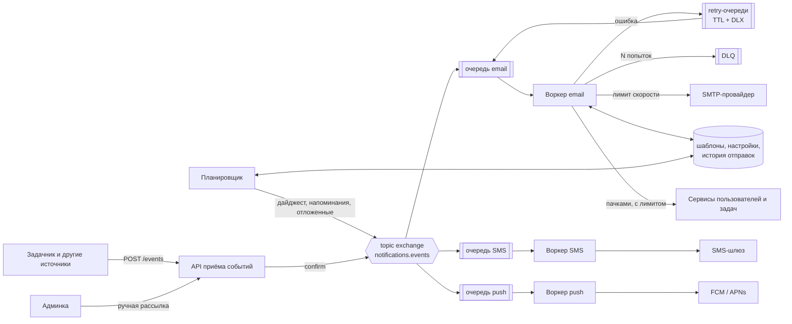

# Разбор: система уведомлений

«Спроектируйте сервис уведомлений» звучит проще чата: получил событие — отправил письмо. Сложность в деталях. Письма не должны теряться и дублироваться, пользователь не хочет получить сто писем подряд или сводку в три часа ночи, а еженедельная рассылка не должна положить почтового провайдера. Разберём на примере «Задачника»: задачи, комментарии, метки, пользователи.

## 1. Требования

**Функциональные:**

- каналы: email сейчас, потом SMS, push и сообщения в открытой вкладке браузера;
- мгновенные уведомления: «вам назначили задачу», «новый комментарий к вашей задаче»;
- отложенные и сводные: «вашу задачу отметили 100 раз» одним письмом в день, еженедельная сводка, напоминание о просроченных задачах;
- ручные рассылки из админки: «плановые работы в субботу», «новая функция»;
- пользователь управляет подписками: отключает категории, задаёт часовой пояс, может отписаться по ссылке из письма;
- единые шаблоны для автоматических и ручных рассылок, менеджер правит их без релиза.

**Нефункциональные:**

- мгновенное уведомление доходит за минуты (SLO: 99% за 5 минут);
- уведомление не теряется, если упал любой компонент;
- нет дублей — в том числе после простоя планировщика, который «догоняет» пропущенные запуски;
- масштабирование под рост пользователей и новые каналы без переписывания существующих.

Как вытягивать такие требования из бизнеса — в [От требований к архитектуре](requirements.md).

## 2. Оценка нагрузки

Пусть 5 млн зарегистрированных пользователей, 1 млн активны в день, и каждый активный порождает 5 событий, о которых надо уведомить:

```text
мгновенные:   1 млн × 5 / 86 400 ≈ 60 в секунду, в пик ×5 ≈ 300
дайджест:     5 млн писем раз в неделю; разослать за 2 часа → 5 млн / 7 200 ≈ 700 в секунду
история:      (5 млн + 5 млн / 7) в день × 300 байт ≈ 1,7 ГБ в день, за 90 дней ≈ 150 ГБ
```

Выводы:

- пиковую нагрузку даёт не поток событий, а **массовые рассылки** — их и надо проектировать в первую очередь;
- 700 писем в секунду — больше, чем разрешает типичный тариф почтового провайдера. Нужен лимит скорости и очередь, которая спокойно копит хвост;
- история отправок растёт быстро: [партицирование](../databases/postgres/partitioning.md) по месяцам и удаление старых партиций.

## 3. Откуда берутся уведомления

| Вид | Пример | Кто запускает |
|---|---|---|
| Мгновенные | назначили задачу, новый комментарий | событие от сервиса-источника |
| Отложенные и сводные | 100 отметок «важно» → одно письмо в день | события копятся, сводку собирает планировщик |
| Периодические | еженедельная сводка, «у вас 3 просроченные задачи» | планировщик |
| Ручные | «плановые работы в субботу» | менеджер в админке |

Напоминание о просроченной задаче — особый случай: это уведомление о том, что **ничего не произошло**. Никакого события нет, его порождает планировщик, проверяя состояние по расписанию.

### Планировщик и дубли после простоя

Cron (или Celery Beat, APScheduler) запускает задание «еженедельная сводка». Если планировщик лежал и при подъёме догоняет пропущенное, а ещё хуже — запущен в двух копиях, сводка уйдёт дважды. Защита в два слоя:

1. **Запись о запуске.** Таблица `scheduler_runs(job, period)` с первичным ключом. Запуск начинается со вставки строки `('weekly-digest', '2026-W44')`; если период уже `done` — выходим.
2. **Ключ идемпотентности рассылки.** Каждое письмо сводки получает детерминированный id `digest:2026-W44:<user_id>`. Если запуск упал на середине и его перезапустили, уже отправленным пользователям второе письмо не уйдёт — его отсечёт уникальный ключ в истории отправок.

Первый слой экономит работу, второй гарантирует отсутствие дублей. Одного первого мало: запуск может упасть между «отправил половину» и «отметил done».

## 4. Компоненты

```text
источники ──► API приёма событий ──► очередь ──► воркер email ──► SMTP-провайдер
(Задачник)          ▲                   │  └──► воркер SMS   ──► SMS-шлюз
                    │                   │  └──► воркер push  ──► FCM / APNs
админка ────────────┤                   │  └──► воркер WebSocket ──► браузер
планировщик ────────┘                   │
                                        ▼
            хранилища: шаблоны, настройки пользователей, история отправок
```

- **API приёма событий** — проверяет контракт события и публикует его в брокер.
- **Очередь** — [RabbitMQ](../microservices/broker/rabbitmq/README.md): нужны повторы с задержкой, DLQ и приоритеты, а не хранение истории. Почему не Kafka — в [сравнении брокеров](../microservices/broker/README.md#rabbitmq-или-kafka).
- **Воркеры по каналам** — у каждого канала своя очередь, свои лимиты и свои ошибки. SMS-шлюз лежит — письма продолжают уходить.
- **Планировщик** — дайджесты, напоминания, возврат отложенных уведомлений.
- **Админка** — шаблоны, ручные рассылки, просмотр истории отправок («почему пользователь не получил письмо?»).
- **Хранилища** — шаблоны (PostgreSQL), настройки и отписки (PostgreSQL, горячее — в кэше), история отправок (PostgreSQL с партициями или ClickHouse для аналитики).

### Почему источники шлют события в API, а не в очередь воркера

Можно было бы дать Задачнику доступ к очереди `notifications.send-email` и писать туда напрямую. Минусы:

- **Нет контракта.** Источник пишет в очередь что угодно, «битое» сообщение обнаружится только в воркере, когда уже поздно отвечать источнику ошибкой. API отвечает `422` сразу.
- **Источник знает внутреннее устройство** — имена очередей, формат, каналы. Добавили SMS — правим все источники.
- **Нет одной точки изменений.** Валидация, дедупликация, лимиты на источник, аудит, версии контракта — в API это пишется один раз.

API публикует событие в topic-обменник, на который подписаны очереди каналов. Внутренние компоненты сервиса уведомлений (планировщик) могут публиковать прямо в обменник — это их собственная инфраструктура. Как описывать контракт — в [Контрактах между сервисами](../microservices/contracts.md).

## 5. Где собирать данные для письма

Письмо «Вам назначена задача „Подготовить релиз“, срок — пятница» требует имени пользователя, адреса, названия задачи и срока. Кто их соберёт?

| Где | Плюсы | Минусы |
|---|---|---|
| В источнике (событие несёт всё) | воркер простой, нет лишних запросов | источник знает, что нужно шаблону; событие раздувается; данные устаревают, пока событие лежит в очереди |
| В API | источник отправляет только id | API становится медленным и зависимым от других сервисов; при их недоступности событие не принять |
| В воркере | данные свежие на момент отправки; источник и API простые | воркер ходит в сервисы пользователей и задач — нужен лимит и кэш |

На практике — **гибрид**: источник кладёт в событие id и несколько неизменяемых полей (`task_id`, `assignee_id`, `actor_id`), воркер обогащает. Для **массовых рассылок** — не событие на пользователя с запросом «дай данные пользователя 1», «пользователя 2»…, а пачками: планировщик берёт 1 000 пользователей, одним запросом получает их задачи и публикует готовые сообщения. 5 млн запросов к сервису пользователей превращаются в 5 тысяч.

### Проверка актуальности перед отправкой

Между событием и отправкой проходят секунды, а при отложенной отправке — часы. Задачу могли закрыть, переназначить, удалить. Поэтому воркер перед отправкой проверяет: задача ещё открыта? исполнитель тот же? Нет — уведомление помечается `skipped (неактуально)`. Напоминать о закрытой задаче хуже, чем не напомнить.

## 6. Политика контактов

Технически отправить письмо можно в любой момент. Но пользователь, получивший 30 писем за час или сводку в 3 часа ночи, отпишется от всего.

- **Часовой пояс и тихие часы.** У пользователя хранится пояс и окно, например 22:00–08:00 по местному времени. Несрочное уведомление в этом окне не отправляется, а откладывается до 08:00: строка в истории со статусом `deferred` и временем `send_after`, планировщик возвращает их в очередь. Хранить отложенное в базе надёжнее, чем в брокере с TTL на 10 часов: виден список, можно отменить.
- **Частотные ограничения.** Не больше N писем одной категории в час на пользователя, остальное — в сводку. Считается [ограничителем частоты](rate_limiting.md) по ключу `user_id:category`.
- **Приоритеты.** Сброс пароля и вход с нового устройства — срочные: игнорируют тихие часы и частотные лимиты, идут отдельной очередью, чтобы их не задержал миллион дайджестов. Дайджест — самый низкий приоритет.
- **Отписка по категориям.** «Комментарии», «назначения», «сводка», «новости продукта». Отписка от служебных (безопасность, оплата) невозможна. В каждом письме — ссылка отписки с подписанным токеном и заголовок `List-Unsubscribe`.
- **Язык.** Шаблон выбирается по языку пользователя, с запасным языком по умолчанию.

## 7. Надёжность

- **Хотя бы один раз + идемпотентность.** Брокер с [ручными подтверждениями](../microservices/broker/rabbitmq/reliability.md#потребитель-ack-prefetch-и-идемпотентность) не теряет сообщения, но может доставить дважды. Каждое уведомление получает `notification_id` = `<event_id>:<user_id>:<канал>`, история отправок держит его уникальным, воркер перед отправкой проверяет статус. Источники — через [Outbox](transactions.md), чтобы событие не потерялось между коммитом и публикацией.
- **Повторы с задержкой.** Временная ошибка (SMTP недоступен) — в retry-очередь с паузой 2 с, 5 с, 10 с… Постоянная (нет такой задачи) — после N попыток в DLQ, разбирать вручную. Как это устроено в RabbitMQ — в [Надёжной обработке](../microservices/broker/rabbitmq/reliability.md#повторы-с-задержкой); общие принципы — в [Устойчивости](resilience.md).
- **Ограничение скорости наружу.** К SMTP-провайдеру — по его тарифу; к сервису пользователей при обогащении — чтобы рассылка не положила его. См. [исходящий лимит](rate_limiting.md#исходящий-лимит).
- **Отказ внешнего провайдера.** Если SMTP лежит долго, нет смысла гонять всю очередь через повторы в DLQ. [Circuit breaker](resilience.md) размыкается, воркеры перестают забирать сообщения — они спокойно копятся в очереди. После восстановления поднимаем потребителей плавно, чтобы накопленный хвост не ударил по провайдеру и не упёрся в его лимит. Для критичных писем — запасной провайдер.
- **Мониторинг.** Возраст старейшего сообщения в очереди (SLO «за 5 минут» нарушается раньше, чем очередь кажется большой), размер DLQ, доля ошибок по провайдерам.

## 8. Отслеживание доставки

«Отправлено» в истории означает только, что SMTP-сервер принял письмо. Что было дальше, узнают из вебхуков провайдера (доставлено, отклонено, жалоба на спам), пикселя открытия и переадресации через свою ссылку для кликов. Адреса с постоянными отказами помечают и больше не используют, иначе провайдер понизит репутацию отправителя. Подробнее — в заметке [Отправка email из Python-сервиса](../web/email/README.md#отслеживание). Доставка в открытую вкладку браузера — через [WebSocket или SSE](../frameworks/fastapi/realtime.md).

## Итоговая схема



## Прогон примера

Упрощённая версия схемы — с одним каналом email — собрана в примере [notifications](../microservices/broker/rabbitmq/examples/notifications/README.md): FastAPI, RabbitMQ, PostgreSQL, Mailpit. Устойчивость к сбоям SMTP и повторы показаны в [Надёжной обработке](../microservices/broker/rabbitmq/reliability.md#прогон-примера), здесь — политика контактов и планировщик:

```text
=== 4а. Отписка от категории
POST /events comment.created → 202
писем в Mailpit: 1
  boris@example.com  Новый комментарий к задаче «Обновить документацию API»
  47a2-94e7-58ca39fc6401:2:email sent
  47a2-94e7-58ca39fc6401:3:email skipped (отписан от comments)

=== 4б. Неактуальное событие: задача уже закрыта
POST /events task.assigned → 202
  41ab-a069-147a1ebd9153:2:email skipped (неактуально)

=== 4в. Тихие часы → отложено, утром отправлено
у Глеба пояс Etc/GMT+10, там сейчас ночь
POST /events task.assigned → 202
писем в Mailpit: 0
  4602-ace3-a36f46b53c55:4:email deferred (тихие часы) до 18:00 UTC
$ python scheduler.py release --all   # «наступило утро»
release: 3e7b133c-0479-4602-ace3-a36f46b53c55:4:email снова в очереди
release: возвращено 1
писем в Mailpit: 1
  gleb@example.com   Вам назначена задача «Настроить резервные копии»
  4602-ace3-a36f46b53c55:4:email sent

=== 5. Планировщик дважды за период → один дайджест
$ python scheduler.py digest
weekly-digest 2026-W44: пачка из 4 пользователей опубликована
weekly-digest 2026-W44: готово, событий 4
$ python scheduler.py digest
weekly-digest 2026-W44: уже выполнен, пропускаю
$ python scheduler.py digest --force
weekly-digest 2026-W44: пачка из 4 пользователей опубликована
weekly-digest 2026-W44: готово, событий 4
писем в Mailpit: 4
  anna@example.com   Сводка за неделю 2026-W44
  boris@example.com  Сводка за неделю 2026-W44
  gleb@example.com   Сводка за неделю 2026-W44
  vera@example.com   Сводка за неделю 2026-W44
  digest:2026-W44:1:email        sent
  digest:2026-W44:2:email        sent
  digest:2026-W44:3:email        sent
  digest:2026-W44:4:email        sent
```

Комментарий к задаче Веры получил только Борис: Вера отписана от комментариев. Третий запуск дайджеста с `--force` обошёл запись о запуске, но писем не прибавилось — их отсёк ключ `digest:2026-W44:<user_id>`. Письмо Борису с той сводкой:

```text
Сводка за неделю 2026-W44
Борис, открытых задач: 1.
- Подготовить релиз 2.0 (просрочена)
```

## Частые ошибки

- **Источники пишут прямо в очередь воркера.** Нет контракта и валидации, добавление канала требует правок во всех источниках.
- **Событие на каждого пользователя при массовой рассылке, с обогащением по одному.** Миллионы запросов к сервису пользователей. Собирайте данные пачками.
- **Нет ключа идемпотентности.** После рестарта воркера или повтора планировщика пользователи получают дубли.
- **Защита от дублей только записью о запуске.** Запуск упал на середине — перезапуск отправит первой половине второй раз.
- **Отправка без проверки актуальности.** Напоминание о задаче, закрытой час назад.
- **Время сервера вместо времени пользователя.** Сводка «в 9 утра» приходит во Владивосток в 16:00, а в Калифорнию — ночью.
- **Срочные письма в общей очереди с рассылкой.** Код подтверждения приходит через 40 минут, когда разошёлся дайджест.
- **Повторы без паузы и предела.** Лежащий SMTP превращается в горячую петлю, «битое» сообщение крутится вечно.
- **Нет отписки по категориям.** Пользователь отписывается от всего, включая важное, или жмёт «Спам» — и страдает репутация домена.

## Связанные темы

- [От требований к архитектуре](requirements.md)
- [Надёжная обработка в RabbitMQ](../microservices/broker/rabbitmq/reliability.md)
- [Брокеры сообщений](../microservices/broker/README.md)
- [Устойчивость: повторы, идемпотентность, circuit breaker](resilience.md)
- [Распределённые транзакции: Outbox](transactions.md)
- [Ограничение частоты запросов](rate_limiting.md)
- [Контракты между сервисами](../microservices/contracts.md)
- [Отправка email из Python-сервиса](../web/email/README.md)
- [Уведомления в реальном времени: WebSocket, SSE](../frameworks/fastapi/realtime.md)
- [Разбор: чат](chat.md)
