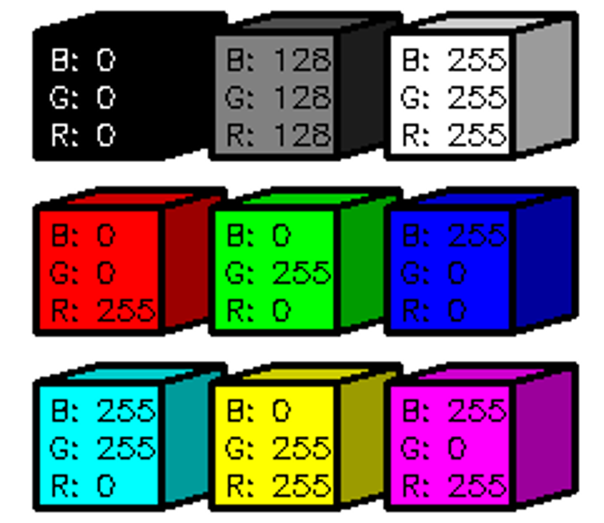

# Адресация пикселей

Самая частая ошибка в OpenCV — перепутать `x` и `y`. Массив NumPy адресуется как `[строка, столбец]`, то есть `[y, x]`, а функции OpenCV (`cv2.circle`, `cv2.rectangle`, `findNonZero`) принимают точки как `(x, y)`. Пока изображение квадратное, ошибка незаметна; на прямоугольном она даёт не тот пиксель или `IndexError`.

## Минимальный пример

Нарисовать точку через OpenCV в координатах `(x=5, y=2)` и прочитать её через NumPy — индексы придётся поменять местами.

```python
import cv2
import numpy as np

image = np.zeros((4, 8, 3), dtype=np.uint8)   # 4 строки (высота), 8 столбцов (ширина)

cv2.circle(image, (5, 2), 0, (0, 0, 255), -1)  # OpenCV: точка (x=5, y=2), красный в BGR

print(image[2, 5])      # [  0   0 255] — NumPy: [y, x]
# print(image[5, 2])    # IndexError: index 5 is out of bounds for axis 0 with size 4

height, width = image.shape[:2]
print(height, width)    # 4 8
```

## Как это работает

### Оси изображения

При работе с изображениями в OpenCV важно понимать, как происходит адресация пикселей.

- Ось X направлена слева направо.
- Ось Y направлена сверху вниз.
- Координата `(0, 0)` соответствует верхнему левому углу изображения.



### Два порядка координат

В OpenCV изображения хранятся в виде массивов NumPy, где каждая ячейка — пиксель. При обращении к элементам массива **NumPy** сначала указывается координата по оси Y (строка), а затем по оси X (столбец): `image[y, x]`.

Во всех функциях **OpenCV** координаты передаются в привычном математическом порядке — сначала X, потом Y: `(x, y)`. То же относится к размерам: `image.shape` даёт `(высота, ширина)`, а `cv2.resize` ожидает `(ширина, высота)`.

```python
import cv2

image = cv2.imread('pixel3x3.png')

pixel_color = image[1, 2]
print(pixel_color)   # [255   0   0] — синий пиксель: строка 1, столбец 2

image[1, 2] = (0, 255, 0)      # записать зелёный в тот же пиксель
blue, green, red = image[1, 2]
print(image[1, 2, 2])          # 0 — только красный канал
```

| Что нужно | NumPy | OpenCV |
|---|---|---|
| пиксель | `image[y, x]` | `cv2.circle(image, (x, y), ...)` |
| размер | `image.shape -> (h, w, c)` | `cv2.resize(image, (w, h))` |
| прямоугольник | `image[y1:y2, x1:x2]` | `cv2.rectangle(image, (x1, y1), (x2, y2), ...)` |

Удобный приём — сразу после чтения распаковать размеры и дальше использовать имена: `height, width = image.shape[:2]`.

## Частые ошибки

- `image[x, y]` вместо `image[y, x]` → на квадратной картинке результат зеркален по диагонали, на прямоугольной — `IndexError` → первый индекс всегда строка.
- `cv2.resize(image, (height, width))` → изображение получается повёрнутых пропорций → OpenCV ждёт `(width, height)`.
- Координаты `float` из вычислений переданы в функции рисования → `TypeError` или `cv2.error: ... can't parse 'center'` → привести к `int` или использовать `np.round(...).astype(int)`.
- Результат `np.where` или `np.argwhere` подставлен в функции OpenCV как есть → они возвращают `(строка, столбец)`, то есть `(y, x)`, и точка рисуется не там → переставить элементы или брать `cv2.findNonZero`, который возвращает `(x, y)`.
- Цвет записан как RGB `(255, 0, 0)` в ожидании красного → в BGR это синий → помнить порядок каналов OpenCV.

## Когда не использовать

Для доступа к одному пикселю через `image[y, x]` ничего лучше не нужно, но перебирать так всё изображение в цикле нельзя: миллион обращений к массиву из Python занимает секунды. Операции над всеми пикселями пишут через срезы, маски и функции NumPy.

Если обработка идёт в библиотеке с другим соглашением — Pillow хранит `(ширина, высота)` и RGB, matplotlib показывает RGB, — координаты и каналы приводят один раз на границе между библиотеками, а не на каждом вызове.

## Связанные темы

- [Чтение изображения](read_image.md)
- [Индексация и срезы](../numpy/indexing.md)
- [Поиск пикселя по цвету](find_pixel.md)
