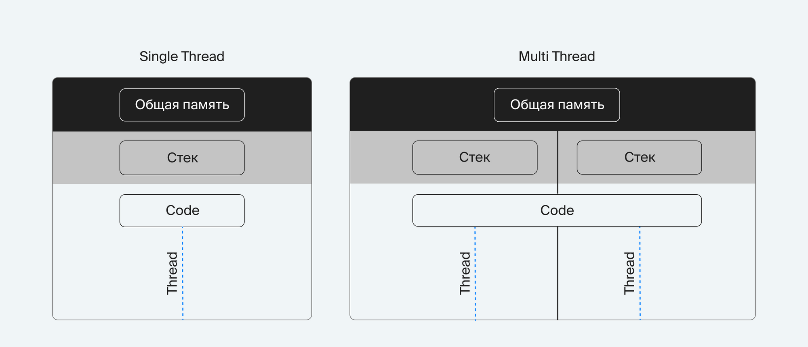

# Конкурентность в Python

«Задачник» рассылает напоминания: сто писем, и после каждого программа ждёт ответа почтового сервера. Процессор при этом простаивает, а сто ожиданий по секунде складываются в почти две минуты. Конкурентность — способ выполнять несколько задач так, будто они идут одновременно, чтобы ожидание одной не останавливало остальные. В Python для этого три инструмента: потоки (`threading`), процессы (`multiprocessing`) и цикл событий (`asyncio`). Здесь — общие понятия, которые нужны для всех трёх; подробности по каждому — в заметках из содержания.

## Содержание

- [Цикл событий asyncio наглядно](event_loop_visual.md) — анимация и запуск кода в браузере
- [Асинхронность (asyncio)](async.md)
- [Цикл событий своими руками](event_loop.md) — планировщик на генераторах и selectors
- [Многопоточность (threading)](multithreading.md)
- [Гонка потоков и Lock наглядно](race_visual.md) — анимация потерянного обновления и критической секции
- [Процессы (multiprocessing)](multiprocessing.md)
- [Пул потоков (ThreadPoolExecutor)](thread_pool.md)
- [Сокеты](sockets.md)
- [Demo: multiprocessing](examples/mp_demo_1.py)

## Минимальный пример

Три письма отправляются в трёх потоках. Пока один поток ждёт ответа сервера, работают остальные:

```python
import threading
import time

def send(email: str) -> None:
    time.sleep(1)  # ждём ответа почтового сервера
    print(f'отправлено: {email}')

emails = ['vera@example.com', 'boris@example.com', 'gleb@example.com']

start = time.perf_counter()
threads = [threading.Thread(target=send, args=(email,)) for email in emails]
for thread in threads:
    thread.start()
for thread in threads:
    thread.join()
print(f'{time.perf_counter() - start:.1f} с')
# отправлено: vera@example.com
# отправлено: boris@example.com
# отправлено: gleb@example.com
# 1.0 с — три ожидания прошли одновременно, а не 3 с подряд
```

Порядок строк «отправлено» может отличаться от запуска к запуску: потоки завершаются независимо друг от друга.

## Как это работает

Многозадачность — это способ выполнения нескольких задач в одной системе так, будто они выполняются одновременно, хотя внутри компьютер обычно делает только одну вещь в каждый конкретный момент времени.

1. Кооперативная (asyncio)
2. Принудительная (threading)
3. Параллельная (multiprocessing)

Закон Амдала: любая программа будет работать со скоростью наименее производительной её части при неограниченном количестве вычислительных ресурсов.

### Процессы
Процесс — это отдельный экземпляр интерпретатора Python (CPython), со своей выделенной памятью и собственным GIL.

- каждый процесс имеет свою независимую область памяти (кучу (heap), глобы, стеки), а взаимодействие идёт только через межпроцессное взаимодействие (IPC): пайпы, очереди, сокеты, shared memory
- процессы могут выполняться физически параллельно на разных ядрах и обеспечивают реальный параллелизм CPU, но для многопроцессорной работы количество ядер - не ограничение, ОС переключается между ними, планируя время работы процессов. Количество процессов ограничены только памятью и настройками ОС
- когда процесс создаёт новый процесс (через fork()), то родитель и ребёнок получают один и тот же набор страниц памяти, но только «для чтения». Копирование страниц происходит только если один из процессов попытается их изменить. Это механизм Copy-On-Write (копирование при записи), который экономит память и добавляет скорость работы

### Потоки

Поток — это исполнительная единица внутри одного процесса Python, разделяющая общую память (heap и память ОС) и один интерпретатор CPython.

- процесс может создать столько потоков, сколько позволяют настройки операционной системы либо на сколько хватит ОЗУ
- все потоки работают внутри одного процесса и одной области памяти, все видят одинаковые Python-объекты, но каждому потоку выделяется свой stack, в которой хранятся локальные переменные, но они берут данные из общей кучи (heap)
- все потоки делят один GIL (Global Interpreter Lock), поэтому поток не может выполнять Python-байткод параллельно с другим потоком, но может выполнять I/O-процессы параллельно (файлы, сеть, ожидание)



### Файл-дескриптор

Файл-дескриптор — это уникальный идентификатор открытого файла в операционной системе. Когда программа пытается открыть файл, ОС проверяет права на файл, предоставляет к нему доступ, создаёт запись в глобальной таблице файлов и предоставляет процессу расположение записи.

Файловый дескриптор — это номер, по которому процесс обращается к открытому ресурсу I/O

Дескриптор — это уникальное неотрицательное целое число — 0, 42 или 841. Один файловый дескриптор существует для каждого открытого файла в системе. Когда процесс делает успешный запрос на открытие файла, ядро возвращает дескриптор файла, который указывает на запись в глобальной файловой таблице ядра. Запись в таблице файлов содержит индексный дескриптор файла, смещение байта и ограничения доступа для этого потока данных.

Начальные файл-дескрипторы (создаются для каждого процесса в ОС):
0 - Стандартный ввод → STDIN (`input()`): Поток данных по умолчанию для ввода, например, при получении ввода из терминала.
1 - Стандартный вывод → STDOUT (`print(...)`): Поток данных для вывода, например, когда команда печатает текст. В терминале это экран пользователя.
2 - Стандартный вывод ошибок → STDERR (`print(..., file=sys.stderr)`): Поток данных для вывода ошибок, связанный с возникшей ошибкой. В терминале это тоже экран пользователя.

### Межпроцессная передача данных (IPC)

IPC (Inter-Process Communication или межпроцессная передача данных) — организация передачи данных между процессами.

Основные модели обмена данными:
- Общая память (shared memory). Выделение некоторой области памяти внутри ОС. Создание сегмента памяти в ОЗУ, который доступен всем процессам через файловый дескриптор
- Обмен сообщениями:
    - Прямой обмен сообщениями подразумевает, что процесс знает, какому другому процессу отправляется сообщение
    - Косвенный обмен сообщениями - создание так называемых «портов» (ports), через которые процессы отправляют сообщения друг другу. При этом у них нет необходимости знать о том, какой именно процесс прочитает данные по этому «порту». Он делится на блокирующий (синхронный) и неблокирующий (асинхронный). Основное различие — в необходимости ждать (или не ждать) чтение данных другим процессом или получение данных от другого процесса.

### Конкурентность в псевдомногозадачиности

- Вытесняющая многозадачность (preemptive): операционная система сама решает, когда нужно переключать задачи в зависимости от их приоритета. Основное преимущество — задачи всегда будут переключаться, даже если какая-то из них подвисла. Но необходимо защищать все данные внутри задач от переключений после любой инструкции кода
- Кооперативная многозадачность (cooperative): каждая задача должна сама сообщить, что готова отдать ресурс другим задачам. Но возможна блокировки всех задач, если не было явной передачи управления

### Основные типы задач

- CPU bound-задачи - необходимо интенсивное использование процессора (использование сложных математических моделей, обучение нейронных сетей, рендеринг графики и вычисление хэшей)
- I/O bound-задачи (non-RAM I/O bound) - основная часть работы приходится на ввод/вывод информации — I/O или input/output (работа с файловой системой и с сетью)
- Memory bound-задачи (RAM I/O bound) - интенсивная работа с оперативной памятью (работа со сложными математическими моделями)

### Асинхронные веб-фреймворки

Все они строятся вокруг цикла событий, но появились в разное время и решают задачу на разном уровне:

- **Twisted** — появился задолго до `asyncio`. Цикл событий называется reactor, а результат будущей операции — объект `Deferred`, к которому цепляют колбэки. Поддерживает множество протоколов, не только HTTP. Сейчас встречается в старых проектах и сетевых инструментах, новый код на нём почти не пишут: колбэки читать тяжелее, чем `async`/`await`, и экосистема у него своя, а не общая с `asyncio`.
- **aiohttp** — HTTP-клиент и сервер поверх `asyncio`. Низкоуровневый: маршруты, middleware и сессии есть, а валидацию данных, сериализацию и документацию нужно собирать самому. Как асинхронный HTTP-клиент он популярен до сих пор, хотя часто его заменяет `httpx`.
- **FastAPI** — надстройка над Starlette (ASGI) и Pydantic. Из подсказок типов он сам получает валидацию входных данных, сериализацию ответа и документацию OpenAPI, есть внедрение зависимостей. Для нового асинхронного API это выбор по умолчанию.
- **Django** поддерживает `async def` во view, но ORM и большая часть экосистемы всё ещё синхронные: асинхронный вызов ORM уходит в пул потоков. Для API, который в основном ждёт сеть (Elasticsearch, Redis, другие сервисы), выгоднее фреймворк, асинхронный целиком.

Главное правило для любого из них: одна блокирующая операция внутри корутины (`time.sleep`, синхронный драйвер базы, `requests`) останавливает цикл событий, и вместе с ней ждут все остальные запросы.

## Частые ошибки

- **Потоки для вычислений.** Из-за GIL байткод Python в потоках выполняется по очереди, и хэширование паролей в десяти потоках идёт не быстрее, а медленнее из-за переключений. Для CPU-bound задач — процессы (`multiprocessing`, `ProcessPoolExecutor`).
- **Процессы для тысячи сетевых запросов.** Каждый процесс — отдельный интерпретатор: запуск занимает сотни миллисекунд, память не делится, аргументы и результаты копируются через pickle. Для I/O-bound задач — потоки или `asyncio`.
- **Общие данные без блокировки.** Два потока увеличивают один счётчик, и часть обновлений теряется: итог меньше ожидаемого, причём не при каждом запуске. Изменения общих данных — под `Lock` или через `queue.Queue`.
- **Блокирующий вызов внутри корутины.** `time.sleep`, `requests.get` или синхронный драйвер базы останавливают цикл событий, и все остальные запросы ждут. В корутинах — `await asyncio.sleep`, асинхронные клиенты, а синхронный код — через `asyncio.to_thread`.
- **Потерянное исключение в потоке.** Ошибка внутри `Thread` печатается в `stderr`, а программа продолжает работать, как будто всё хорошо. Запускайте задачи через `ThreadPoolExecutor` и читайте `future.result()`: он поднимет исключение в вызывающем коде.

## Когда не использовать

Если скрипт делает один запрос и выходит или обрабатывает данные за секунды, конкурентность только добавляет сложности: непредсказуемый порядок вывода, блокировки, трудная отладка. Сначала измерьте, куда уходит время. Если на ожидание сети и диска — потоки или `asyncio`; если на вычисления — процессы, а чаще выгоднее перенести расчёт в NumPy или в запрос к базе данных.

Вычисления, которые помещаются в одну секунду, не стоит распараллеливать вовсе: запуск процессов и передача данных между ними займут больше, чем сама работа. Ускорение по закону Амдала ограничено последовательной частью программы, поэтому выгоднее сначала убрать её, а потом добавлять потоки и процессы.

## Связанные темы

- [Цикл событий asyncio наглядно](event_loop_visual.md)
- [Многопоточность (threading)](multithreading.md)
- [Процессы (multiprocessing)](multiprocessing.md)
- [Пул потоков (ThreadPoolExecutor)](thread_pool.md)
- [Celery](../../../backend/frameworks/celery/README.md) — фоновые задачи в отдельных процессах
- [Асинхронность в FastAPI: def или async def](../../../backend/frameworks/fastapi/first_app.md#def-или-async-def)
