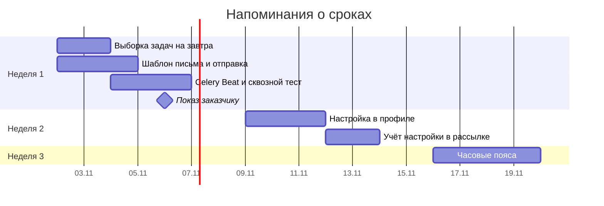

# Работа над проектом в команде

Команда из трёх человек четыре недели писала сервис. Каждый взял свою часть: один — регистрацию, другой — роли, третий — защиту от перебора паролей. На первом показе заказчику выяснилось, что регистрация есть, а войти нельзя: вход в планах на следующую неделю. Код хороший, а пользоваться нечем. Здесь собраны приёмы, которые помогают каждую неделю показывать результат, а не «почти готовые» куски: декомпозиция по фичам, понятные задачи, честная оценка сроков и подготовка к защите архитектуры.

## Минимальный пример

Фича «Задачника»: напоминать пользователю о задачах, у которых завтра срок. Плохой план режет её по слоям, хороший — по тому, что получит пользователь.

```text
По слоям (к концу недели нечего показать):
  Вера  — все модели и миграции
  Борис — весь API
  Глеб  — все письма и Celery

По фичам (к концу недели работает первая версия):
  Неделя 1. Письмо о завтрашнем сроке всем пользователям
    Вера  — поле due_date и выборка задач на завтра
    Борис — шаблон письма и отправка
    Глеб  — задача Celery Beat в 9:00 и тест на всю цепочку
  Неделя 2. Пользователь выключает напоминания в настройках
  Неделя 3. Напоминание в часовом поясе пользователя
```

Каждая неделя заканчивается тем, что можно показать: «вот письмо пришло», «вот я выключил напоминания, и письма нет».

## Декомпозиция

Большую цель режут, пока каждый кусок не станет понятным. Названия уровней в разных командах свои, но смысл один:

- **эпик** — крупная часть работы, которую нельзя сделать за один заход: «Напоминания о сроках»;
- **фича** — законченный кусок пользы для пользователя, с тестами, доступный хотя бы на тестовом стенде: «Пользователь выключает напоминания»;
- **задача** — работа одного человека на часы или пару дней: «Добавить поле `reminders_enabled` и миграцию».

Резать стоит по фичам, а не по слоям или технологиям. Тогда после каждой фичи у продукта появляется новая возможность, и если сроки сорвутся, часть пользы уже будет у пользователей. Работа по фичам требует, чтобы задачи соседей стыковались, поэтому их приходится описывать подробнее, чем «сделать API».

На проверку декомпозиции команда собирается целиком. Проверяют:

- понятна ли цель и не осталось ли открытых вопросов;
- что будет, если база, брокер или соседний сервис ответит ошибкой. Например, страница показывается без блока рекомендаций, а не падает с 500. Подробнее — в заметке [Устойчивость](../../backend/design/resilience.md);
- какая нагрузка ляжет на каждый сервис;
- какие данные и ошибки передаются через API и кто от него зависит;
- как фичу протестируют, выпустят и как поймут, что она здорова.

## Как описать задачу

Задача из одного заголовка — «Сделать каптчу» — откладывает разговор на потом. Через неделю исполнитель будет выяснять заново, что имелось в виду. Хватает трёх пунктов:

```text
Выключение напоминаний в настройках

Что и зачем:
  Пользователи жалуются на ежедневные письма. Нужна настройка
  «Присылать напоминания о сроках», по умолчанию включена.

Ограничения:
  Мобильный клиент старой версии не знает о новом поле:
  ответ GET /me должен остаться совместимым.

Готово, когда:
  - PATCH /me принимает reminders_enabled и сохраняет его;
  - пользователю с выключенной настройкой письмо не уходит (тест);
  - поле описано в OpenAPI.
```

Последний пункт — критерий готовности (definition of done). Без него «почти готово» может длиться неделю. Полезно дописать, к кому идти с вопросами и кто уже делал похожее.

## Оценка сроков и риски

Ошибка в оценке почти всегда в одну сторону: задача занимает больше, чем казалось. Причины — неопределённость (технология незнакома, требования неясны), человеческий фактор (опечатка, которую искали полдня) и внешние события (заболел коллега, упал стенд).

Что помогает:

- **резать до понятного.** «Сделать сервис уведомлений» не оценить. «Добавить поле и миграцию» оценивается в часах;
- **оценивать диапазоном.** Для каждой задачи три числа: если всё пойдёт хорошо, как обычно, если всё пойдёт плохо;
- **неизвестное — отдельной задачей.** «Разобраться, как Celery Beat работает с часовыми поясами, 4 часа» лучше, чем заложить неизвестность во все задачи сразу.

Трёх оценок хватает, чтобы посчитать ожидаемый срок. Формула PERT: среднее с весом для обычного случая, `(лучший + 4 × обычный + худший) / 6`:

```python
from math import sqrt

tasks = {
    'Таблица подписок пользователя': (2, 3, 6),
    'API настроек напоминаний': (3, 4, 8),
    'Письмо по шаблону': (2, 4, 12),
    'Задача Celery Beat на рассылку': (3, 5, 16),
    'Тесты и CI': (2, 3, 5),
}

total_mean = 0.0
total_var = 0.0
for title, (best, likely, worst) in tasks.items():
    mean = (best + 4 * likely + worst) / 6
    sigma = (worst - best) / 6
    total_mean += mean
    total_var += sigma ** 2
    print(f'{title:<32} {best:>2}/{likely:>2}/{worst:>2} ч → {mean:4.1f} ч')

naive = sum(likely for _, likely, _ in tasks.values())
print(f'Сумма «наиболее вероятных»: {naive} ч')
print(f'Ожидаемая оценка: {total_mean:.1f} ч, с запасом в две сигмы: {total_mean + 2 * sqrt(total_var):.1f} ч')
```

```text
Таблица подписок пользователя     2/ 3/ 6 ч →  3.3 ч
API настроек напоминаний          3/ 4/ 8 ч →  4.5 ч
Письмо по шаблону                 2/ 4/12 ч →  5.0 ч
Задача Celery Beat на рассылку    3/ 5/16 ч →  6.5 ч
Тесты и CI                        2/ 3/ 5 ч →  3.2 ч
Сумма «наиболее вероятных»: 19 ч
Ожидаемая оценка: 22.5 ч, с запасом в две сигмы: 28.5 ч
```

Сумма «обычных» оценок — 19 часов, но худшие случаи далеко, а лучшие близко. Поэтому ожидаемый срок больше, а заказчику безопаснее называть верхнюю границу. Сами числа условны: метод показывает, где неопределённость больше всего («Задача Celery Beat», от 3 до 16 часов). Её и стоит уточнить первой.

## Как вести работу

- **Водопад (waterfall).** Этапы идут строго по очереди: всё спроектировать, всё сделать, всё проверить, выпустить. Сроки и стоимость известны заранее, но менять план по ходу почти нельзя. Подходит, когда требования зафиксированы договором и не изменятся.
- **Scrum.** Работа идёт короткими итерациями (спринтами) по 1–4 недели. Внутри спринта задачи проходят все этапы, в конце — показ результата и корректировка плана. Каждый день короткая встреча или сообщение в чате: что сделал, что мешает, что дальше.
- **Kanban.** Доска с колонками («в очереди», «в работе», «на ревью», «готово») — единственный источник правды о состоянии задач. Спринтов нет, работа течёт непрерывно. Важное правило — ограничить число задач в работе: пять начатых задач хуже двух законченных.

На практике подходы смешивают: план крупных этапов — как в водопаде, работа внутри — по Scrum или Kanban.

**Диаграмма Ганта** показывает план на шкале времени: задачи, их длительность и зависимости. Её удобно приносить на защиту: видно, что за чем идёт и где критический путь. Mermaid рисует её прямо в Markdown:



## Показ результата

Заказчику неинтересно, сколько появилось классов. Ему важно, что теперь умеет продукт:

- в начале недели команда называет, что покажет в конце. Короткий список без технических подробностей;
- лучший показ — живая демонстрация работающего сервиса. Если боитесь, что что-то сломается, заранее запишите видео;
- то, что не показать на экране (архитектура, ускорение в 10 раз), — на паре слайдов;
- рассказывайте и о решениях, которые не сработали: это тоже результат;
- если не успеваете, говорите сразу, а не в день показа. Можно урезать задачу до минимума, поменяться задачами, взять готовую библиотеку или осознанно упростить архитектуру. Плохо только, когда изменение плана становится сюрпризом.

## Защита архитектуры

На защите архитектуры смотрят не на код, а на решение: выдержит ли оно сбои и рост нагрузки, легко ли его менять, безопасно ли оно. Что принести:

- задачу: какую проблему решает сервис;
- схему компонентов и описание сценариев. Как её нарисовать — в заметке [От требований к архитектуре](../../backend/design/requirements.md#описание-архитектуры);
- план с эпиками, например диаграмму Ганта;
- работающую минимальную версию (MVP).

Главная подготовка — к вопросам. Типичные:

- **«Что будет, если сервис упадёт посреди работы?»** Ответ с механизмом: задача пишет прогресс в базу и после перезапуска продолжает с последнего шага.
- **«Почему не взяли готовое решение?»** Назовите, что рассматривали и почему отказались: дорого на наших объёмах, не умеет нужного. Решения стоит фиксировать в [ADR](../../backend/design/requirements.md#adr-записываем-решения) ещё во время работы.
- **«Какие ограничения у сервиса?»** Конкретные числа: файлы до 10 ГБ, такие-то форматы, потому что таковы существующие данные.
- **«Как масштабировать?»** Если об этом пришлось спросить, значит, в презентации этого не хватило.

Как найти вопросы заранее:

- выпишите то, что не влезло в презентацию;
- побудьте противником своего решения: как бы вы его сломали;
- попросите кого-то со стороны задать вопросы;
- спросите себя, стали бы вы сами этим пользоваться.

## Частые ошибки

- **Каждый делает «своё».** Через неделю есть три несвязанных куска и ни одной работающей фичи. Делите работу так, чтобы общая цель недели была одна.
- **Задача без критерия готовности.** «Почти готово» тянется неделями. Пишите, как проверить, что задача сделана.
- **Оценка одним числом.** «Два дня» звучит как обещание. Диапазон честнее и сразу показывает риск.
- **Новая технология ради интереса.** Сначала спросите: кто будет её поддерживать, есть ли сообщество, найдутся ли люди в команду через год.
- **Плохие новости в последний день.** Чем раньше команда и заказчик узнают о сдвиге, тем больше у них вариантов.

## Когда не использовать

Для задачи на вечер, которую делает один человек, не нужны ни эпики, ни диаграмма Ганта: хватит записи в трекере с критерием готовности. Формальности стоит добавлять по мере роста команды и цены ошибки, а не впрок.

## Связанные темы

- [От требований к архитектуре](../../backend/design/requirements.md) — требования, SLO, C4, ADR
- [Код-ревью](code_review.md) — как проверять код друг друга
- [Git](../../infrastructure/devtools/git/README.md) — ветки и pull request
- [CI/CD](../../infrastructure/cicd/README.md) — сборка, развёртывание и выпуск, флаги и частые релизы
