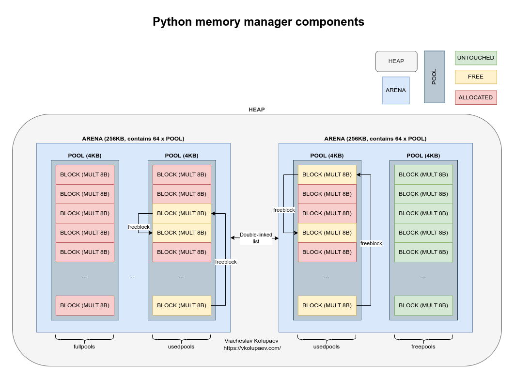
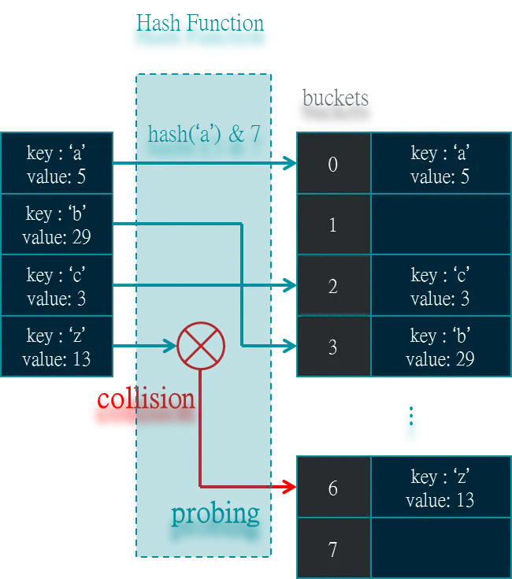

# Основы Python: интерпретатор, память, типы и исключения

Базовый конспект о том, что происходит «под капотом» у обычного кода на Python: как выполняется программа, где живут объекты, как устроены список и словарь. Во второй половине — короткие примеры повседневных конструкций: копирование, comprehensions, исключения, `match`.

## Интерпретатор Python

Видео по теме: [youtube.com/watch?v=f-jFxO2Kzlo](https://www.youtube.com/watch?v=f-jFxO2Kzlo).

Python — интерпретируемый язык: программу не нужно заранее компилировать, как в C или C++. Интерпретатор сам читает исходный код и выполняет его.

При первом запуске сценария интерпретатор проверяет синтаксис и компилирует код в байт-код (bytecode) — низкоуровневое представление исходного кода. Затем байт-код выполняет виртуальная машина Python (Python Virtual Machine, PVM): она по очереди читает инструкции байт-кода и исполняет их.

Байт-код функции можно посмотреть модулем `dis`:

```python run
import dis

def func_(x):
    return x % 2

dis.dis(func_)
```

### Каталог `__pycache__` и файлы `.pyc`

Каталог `__pycache__` интерпретатор создаёт автоматически и хранит в нём скомпилированный байт-код импортированных модулей — и тех, что импортирует ваш сценарий, и тех, что импортируют они.

Файлы `.pyc` — это и есть скомпилированный байт-код. Они создаются при импорте модулей, а ещё их можно использовать, чтобы распространять модули или приложения в скомпилированном виде.

Файлы `.pyc` привязаны к версии Python: файл, созданный одной версией, не подойдёт другой.

## Выделение памяти

Переменная в Python — это имя (метка, label), которое хранит только ссылку на объект.

Сам объект хранит:

- служебный заголовок `PyObject` с двумя полями:
    - `ob_refcnt` — счётчик ссылок: сколько переменных и структур данных указывают на объект;
    - `ob_type` — указатель на тип (`int`, `str` и т. д.). Тип описывает поведение объекта: методы, операции, протоколы;
- данные объекта.

### Стек и куча

Память делится на две области: стек (stack) и кучу (heap).

```python
def foo():
    x = [1, 2, 3]
    y = 10
    return x, y
```

В стеке в порядке LIFO хранятся служебные данные вызова функции `foo` и ссылки (указатели) на объекты для локальных имён `x` и `y`. Например, `x = 0xABC` — адрес объекта в куче.

В куче хранятся сами объекты: список `[1, 2, 3]`, три объекта `1`, `2`, `3`, объект `10`, кортеж `([1, 2, 3], 10)` и объект фрейма с описанием вызова `foo`.

### Аллокатор PyMalloc

В куче объекты лежат где придётся, и память может сильно фрагментироваться. Python создаёт огромное количество маленьких объектов, и для каждого вызывать системный `malloc()` неэффективно: это медленно, фрагментирует память и добавляет много лишней работы (overhead).

Поэтому в CPython есть PyMalloc — специальный аллокатор для малых объектов размером до 512 байт. Он работает поверх системного `malloc()` и делит память на три уровня:

- **Арена** — 256 КБ. Менеджер памяти интерпретатора запрашивает новую арену у ОС через PyMalloc. Объекты больше 512 байт идут мимо арен, напрямую в `malloc()`. Арена хранит 64 пула. Арены сортируются по числу свободных пулов в обратном порядке, чтобы освобождённая память переиспользовалась оптимально.
- **Пул** — 4 КБ внутри арены. Пул хранит фиксированное число блоков одного размера. Заполненные пулы называются `fullpools`, частично заполненные — `usedpools`, пустые — `freepools`.
- **Блок** — фиксированный кусок памяти под объект, от 8 до 512 байт. Блоки бывают нетронутыми (untouched), занятыми (allocated) и освобождёнными (free). Освобождённые блоки уже не содержат нужных данных, но и не возвращены ОС; при записи новых данных они используются в первую очередь.



### Размеры объектов

Функция `sys.getsizeof` показывает, сколько байт занимает объект. Видно, что даже маленькое число занимает десятки байт: большую часть составляет служебный заголовок. А список и словарь растут скачками — память выделяется с запасом.

::: warning Этот пример запускайте локально
В браузере работает 32-битный Python (wasm32), и размеры объектов там примерно вдвое меньше. Ниже — вывод обычного 64-битного CPython 3.12.
:::

```python
import sys

boolean = True
print(sys.getsizeof(boolean))  # 28

num = 10
print(sys.getsizeof(num))  # 28

big_num = 10000
print(sys.getsizeof(big_num))  # 28

float_num = 5.3
print(sys.getsizeof(float_num))  # 24

string = 'hello'
print(sys.getsizeof(string))  # 46

big_string = 'Равным образом реализация намеченных плановых заданий обеспечивает широкому кругу (специалистов) участие в формировании соответствующий условий активизации.'
print(sys.getsizeof(big_string))  # 370

list_a = []
for i in range(10):
    list_a.append(i)
    print(i, sys.getsizeof(list_a))  # размер списка после добавления элемента

dict_a = {}
for i, v in enumerate(range(10)):
    dict_a[i] = v
    print(i, sys.getsizeof(dict_a))  # размер словаря после добавления элемента
```

```text
28
28
28
24
46
370
0 88
1 88
2 88
3 88
4 120
5 120
6 120
7 120
8 184
9 184
0 224
1 224
2 224
3 224
4 224
5 352
6 352
7 352
8 352
9 352
```

## Переаллокация памяти

Переаллокация (reallocation) — повторное выделение участка памяти, обычно большего, реже меньшего: данные копируются в новый участок, а старый освобождается.

Так динамические структуры данных расширяются, когда им перестаёт хватать места. Система выделяет новый, более крупный блок памяти, копирует туда все элементы и освобождает старый блок. Дальше структура работает уже с увеличенной ёмкостью.

```python run
# Когда список заполняет выделенный блок памяти, append() вызывает переаллокацию.
# При большом числе append() таких переаллокаций много.
squares = []
for x in range(10_000_000):
    squares.append(x * x)

# Comprehension добавляет элементы прямо в C-цикле, без вызова метода append().
# Если места не хватает, внутренняя функция list_resize() увеличивает ёмкость
# примерно на 12,5 % от текущего размера.
squares = [x * x for x in range(10_000_000)]
```

В CPython 3.10–3.12 ускорили и `list.append()`, и цикл `for`, а рост списка стал дешевле. Поэтому разница между двумя способами сейчас небольшая:

```python run
import timeit

def test_append():
    squares = []
    for x in range(10_000_000):
        squares.append(x * x)

def test_comprehension():
    squares = [x * x for x in range(10_000_000)]

append_time = timeit.timeit("test_append()", globals=globals(), number=5)
comp_time   = timeit.timeit("test_comprehension()", globals=globals(), number=5)

print(f"append():         {append_time:.3f} сек")
print(f"list comp:        {comp_time:.3f} сек")
print(f"Ускорение:        {append_time / comp_time:.2f}x")
```

Пример выполняется несколько секунд. Конкретные цифры зависят от компьютера, а в браузере код работает медленнее, чем в обычном Python.

## Устройство списка

Список хранит не сами объекты, а ссылки (указатели) на них — массив `PyObject*[]`.

### Получение элемента

1. Проверяет, что индекс `i` в допустимом диапазоне.
2. Вычисляет адрес элемента: `address = base_address + i * sizeof(PyObject*)`.
3. Берёт указатель и увеличивает счётчик ссылок объекта (`INCREF`).
4. Возвращает объект, на который ссылается указатель.

### Добавление элемента `x` в конец

1. Проверяет, есть ли свободное место: сравнивает `len(lst)` и `allocated`. Если места нет — переаллокация.
2. Записывает указатель на `x` в ячейку `items[len]`.
3. Увеличивает счётчик ссылок у `x` (`INCREF`).
4. Увеличивает `len`.

### Вставка элемента `x` в позицию `i`

1. Проверяет индекс `i` и хватает ли выделенной памяти (`allocated`).
2. Сдвигает элементы с индексами `i … len-1` на одну позицию вправо — копируются указатели `PyObject*`.
3. Записывает в позицию `i` указатель на `x`.
4. Увеличивает счётчик ссылок у `x` (`INCREF`).
5. Увеличивает `len`.

### Переаллокация списка

Списки выделяют память с запасом (over-allocation). Если при добавлении элемента `len(lst) == allocated`, Python вычисляет новое значение `allocated` с запасом, выделяет новый непрерывный массив указателей, копирует туда старые элементы и освобождает старый массив.

## Устройство словаря

Словарь — это хеш-таблица, оптимизированная для быстрого доступа по ключу. С Python 3.7 словарь ещё и сохраняет порядок вставки.

Словарь состоит из двух частей:

1. **Таблица слотов** (sparse array) — разреженный массив фиксированного размера. Каждый слот содержит индекс записи или состояние EMPTY / DELETED.
2. **Таблица записей** (compact entries) — плотный массив записей `(hash, key, value)` в порядке вставки.



### Получение элемента

```python
d = {"a": 10, "b": 20, "c": 30}
value = d["b"]
```

1. Вычисляется хеш ключа (64-битное число): `h = hash("b")`.
2. Определяется позиция в таблице слотов. Число слотов всегда — степень двойки (8, 16, 32…), поэтому позицию находят битовой маской: `slot = h & (size - 1)`.
3. Читается содержимое слота: `index = sparse_array[slot]`.
    - `index >= 0` — это индекс записи в таблице записей;
    - `index == -1` — пустой слот, ключа в словаре нет;
    - `index == -2` — удалённая запись, поиск продолжается.
4. Берётся запись из таблицы записей: `entry = entries[index]` — это тройка `(h, key, value)`.
5. Проверяются хеш и ключ:
    ```text
    если entry.hash != h:
        коллизия → пробуем следующий слот
    если entry.key is key:
        успех
    иначе сравниваем ключи через ==
    ```
6. Возвращается значение: `entry.value`.

### Переаллокация словаря

1. Если коэффициент заполнения таблицы слотов (занятые слоты / общий размер) превысил 2/3, создаётся новая, бо́льшая таблица слотов. Активные записи `(hash, key, value)` вставляются в неё заново (reinsert), и таблица индексов заполняется с нуля.
2. Если в таблице слотов накопилось много удалённых (DELETED) слотов, Python тоже перестраивает таблицу: выбрасывает мусор и снова делает раскладку компактной.

### Своя хеш-таблица

Упрощённая реализация словаря на хеш-таблице с цепочками: каждая корзина (bucket) — список пар `(key, value)`. Ключи с одинаковым номером корзины попадают в одну корзину — это коллизия.

```python run
class MyDictionary:
    def __init__(self):
        self.size = 5  # маленький размер, чтобы чаще возникали коллизии
        self.table = [[] for _ in range(self.size)]

    def __setitem__(self, key, value):
        index = hash(key) % self.size
        bucket = self.table[index]

        for i, (k, v) in enumerate(bucket):
            if k == key:
                bucket[i] = (key, value)  # ключ уже есть — обновляем значение
                return

        bucket.append((key, value))

    def __getitem__(self, key):
        index = hash(key) % self.size
        bucket = self.table[index]

        for k, v in bucket:
            if k == key:
                return v

        raise KeyError(key)

    def __repr__(self):
        """Вывод таблицы для отладки."""
        return '\n'.join(
            f"{i}: {bucket}"
            for i, bucket in enumerate(self.table)
        )

d = MyDictionary()

d['apple'] = 'red'
d['banana'] = 'yellow'
d['cherry'] = 'red'

print(d['apple'])    # red
print(d['banana'])   # yellow
print(d['cherry'])   # red

print("\nВнутреннее состояние таблицы:")
print(d)
```

Раскладка по корзинам при каждом запуске может быть разной. Хеш строки в Python «солится» случайным числом при старте интерпретатора (см. переменную окружения `PYTHONHASHSEED`) — это защита от атак, подбирающих ключи с одинаковым хешем. Поэтому иногда все ключи окажутся в разных корзинах, а иногда два или три — в одной.

## Операторы `==` и `is`

Оператор `==` сравнивает значения, а `is` — идентичность: указывают ли две переменные на один и тот же объект в памяти.

```python run
a = [1, 2, 3]
b = [1, 2, 3]
print(a == b)  # True
print(a is b)  # False — два разных списка

a = b
print(a == b)  # True
print(a is b)  # True — теперь это один объект
```

## Проверка типов

```python run
print(type(5))         # <class 'int'>
print(type("hello"))   # <class 'str'>

# type() не считает подкласс тем же типом: для True условие type(x) is int ложно
x = 5
if type(x) is int:
    print(x)

# isinstance проверяет, что объект — экземпляр класса или его наследника
print(isinstance(5, int))                 # True
print(isinstance(True, int))              # True (bool — подкласс int)
print(isinstance([1, 2], (list, tuple)))  # True: подходит любой из типов

# Проверка всех элементов списка
x = [1, 2, 3, 4, 5]
if all(isinstance(i, int) for i in x):
    print("Все элементы — числа")

# Пользовательские типы
class A: pass
class B(A): pass

b = B()

print(isinstance(b, A))   # True (B наследует A)

# Утиная типизация (duck typing): важен не тип, а наличие нужного метода
def f(x):
    if hasattr(x, "__len__"):
        print("У объекта есть длина:", len(x))

f([1, 2, 3])  # У объекта есть длина: 3
```

## Интернирование

Интернирование (interning) — оптимизация, при которой одинаковые неизменяемые объекты (например, строки и числа) хранятся в памяти один раз и переиспользуются.

```python run
# Числа от -5 до 256 CPython создаёт заранее и всегда берёт из кэша
num_a = 5
num_b = 5
print(num_a is num_b)  # True

# Числа больше 256 не кэшируются
big_num_a = 1000
big_num_b = 1000
print(big_num_a is big_num_b)  # зависит от способа запуска (см. ниже)

# Короткие строки, похожие на идентификаторы, интернируются автоматически
a = "hello"
b = "hello"
print(a is b)  # True

# Строка с пробелом автоматически не интернируется
a = "hello world"
b = "hello world"
print(a is b)  # зависит от способа запуска (см. ниже)

# Изменяемые объекты не интернируются никогда
list_a = [1, 2, 3, 4, 5]
list_b = [1, 2, 3, 4, 5]
print(list_a is list_b)  # False

# Интернирование вручную
import sys
a = sys.intern("hello world")
b = sys.intern("hello world")
print(a is b)  # True
```

Результаты для `1000` и `"hello world"` — деталь реализации CPython, а не правило языка:

- В Jupyter каждая строка ячейки компилируется отдельно, и оба сравнения дают `False`.
- В обычном скрипте и в браузере весь блок компилируется целиком. Компилятор замечает одинаковые константы и хранит каждую один раз, поэтому оба сравнения дают `True`.

Гарантированы только кэш маленьких чисел, `False` для изменяемых объектов и `True` после `sys.intern`. Поэтому значения всегда сравнивайте через `==`, а `is` оставьте для `None`, `True` и `False`.

## Присваивание, поверхностная и глубокая копии

```python run
import copy

# Присваивание: b ссылается на тот же объект, что и a
a = [1, [2]]
b = a
b.append(3)
b[1].append(4)
print(a)  # [1, [2, 4], 3]

# Поверхностная копия: копируется только внешний список,
# вложенный список у a и b общий
a = [1, [2]]
b = copy.copy(a)
b.append(3)
b[1].append(4)
print(a)  # [1, [2, 4]]

# Глубокая копия: копируются и вложенные объекты
a = [1, [2]]
b = copy.deepcopy(a)
b.append(3)
b[1].append(4)
print(a)  # [1, [2]]

# Другие способы сделать поверхностную копию списка
b = list(a)
b = a[:]
b = [i for i in a]
b = a.copy()
```

## Операторы `and`, `or`, `not`

`and` и `or` возвращают не `True`/`False`, а один из операндов: `and` — первый ложный (или последний), `or` — первый истинный (или последний). `not` всегда возвращает `bool`.

```python run
print(not {1, 2, 3})  # False
print([] and 1)       # []
print([] or 1)        # 1
```

## Генераторы коллекций (comprehensions)

```python run
# Списка
list_ = [i for i in range(5) if i % 2 == 0]
print(list_)  # [0, 2, 4]

# Множества
set_ = {i for i in range(5) if i % 2 == 0}
print(set_)  # {0, 2, 4}

# Словаря
dict_ = {i: i**2 for i in range(5) if i % 2 == 0}
print(dict_)  # {0: 0, 2: 4, 4: 16}
```

## Перебор с `range`, `enumerate`, `zip`

```python run
num = 3

# range — последовательность чисел: от 1 до num (не включая) с шагом 2
for n in range(1, num, 2):
    print(f"Значение: {n}")

fruits = ["apple", "banana", "cherry"]

# enumerate — элементы вместе с индексами
for index, fruit in enumerate(fruits):
    print(index, fruit)

a = [1, 2, 3]
b = [4, 5, 6, 7]
c = [8, 9]

# zip — параллельный перебор; останавливается на самой короткой коллекции
for i in zip(a, b, c):
    print(i)
```

## Сборщик мусора (GC)

Когда объект больше не нужен — например, на него не осталось ссылок, — он становится мусором (garbage), и сборщик мусора (garbage collector) освобождает его память.

Основа управления памятью в Python — подсчёт ссылок (reference counting): для каждого объекта хранится число ссылок на него. Когда оно становится равным нулю, память освобождается сразу.

Кроме этого, в Python есть сборка мусора по поколениям (generational garbage collection). Она делит объекты на несколько «поколений» и проверяет их с разной частотой. Этот механизм находит циклические ссылки, которые подсчёт ссылок не видит.

`sys.getrefcount` показывает число ссылок на объект. Оно на единицу больше ожидаемого: аргумент самой функции — тоже ссылка.

```python run
import sys

arr_1 = []
arr_2 = arr_1
print(sys.getrefcount(arr_1))
```

`gc.collect()` принудительно запускает сборку мусора и возвращает число найденных недостижимых объектов:

```python run
import gc

gc.collect()
```

### Поиск утечек памяти

Для отладки утечек памяти есть сторонние инструменты:

- **memory_profiler** — запустите программу командой `python -m memory_profiler my_script.py`. Для функций с декоратором `@profile` появится построчный отчёт: сколько памяти используется в каждой строке и где она растёт.
- **objgraph** — рисует граф ссылок. Пример ниже создаст изображение `my_list.png` со всеми объектами, на которые ссылается `my_list`.

::: warning Этот пример запускайте локально
Нужны сторонние пакеты `memory_profiler` и `objgraph` (а для картинки — ещё Graphviz), в браузере их нет.
:::

```python
from memory_profiler import profile

@profile
def my_func():
    # код, который может вызывать утечку памяти
    pass
```

```python
import objgraph

my_list = [1, 2, 3]
objgraph.show_refs([my_list], filename='my_list.png')
```

## GIL

Статья по теме: [tproger.ru/translations/global-interpreter-lock-guide](https://tproger.ru/translations/global-interpreter-lock-guide).

Глобальная блокировка интерпретатора (Global Interpreter Lock, GIL) — механизм CPython, который гарантирует, что в любой момент времени байт-код Python выполняет только один поток. GIL защищает внутренние структуры интерпретатора в многопоточной среде и упрощает его реализацию.

## Рекурсия

Рекурсивное решение компактнее, но тратит больше памяти: каждый вызов занимает кадр стека. Кроме того, глубина рекурсии ограничена — по умолчанию примерно 1000 вызовов (`sys.getrecursionlimit()`).

```python run
def factorial(n):
    if n <= 1:
        return 1
    return n * factorial(n - 1)

print(factorial(5))  # 120
```

То же самое циклом — без ограничения на глубину:

```python run
def factorial(n):
    num = 1
    while n >= 1:
        num = num * n
        n = n - 1
    return num

print(factorial(5))  # 120
```

## Обработка исключений

```python run
a = 10
b = 0

try:
    # код, который может завершиться ошибкой
    result = a / b
except ZeroDivisionError:
    # выполняется, если в try возникла указанная ошибка (блоков except может быть несколько)
    result = None  # резервное значение
else:
    # выполняется, если в try ошибок не было
    ...
finally:
    # выполняется в любом случае
    ...

print(result)  # None
```

### Несколько блоков `except`

Срабатывает первый подходящий блок `except`, поэтому более конкретные исключения ставят выше общих.

```python run
try:
    raise ValueError(1)
except ValueError:
    print("ValueError")  # сработает этот блок
except Exception:
    # если поставить этот блок первым, сработает он: Exception — базовый класс для ValueError
    print("Exception")
```

В одном `except` можно перечислить несколько типов кортежем. Если исключение не подошло ни под один `except`, его обработает интерпретатор — программа завершится с ошибкой.

```python run
try:
    raise TypeError(1)
except (ValueError, TypeError):
    print("Value or Type Error")
except SyntaxError:
    print("SyntaxError")
```

`except` без типа ловит всё, включая исключения, которые не наследуют `Exception`, а наследуют напрямую `BaseException` — например, `GeneratorExit`, `KeyboardInterrupt`, `SystemExit`.

```python run
try:
    raise GeneratorExit
except Exception:
    print("Exception")
except:
    print("Base Exception")
```

### Повторный выброс исключения (re-raise)

Если внутренний обработчик поймал ошибку, внешний её уже не увидит. Чтобы передать ошибку дальше, во внутреннем обработчике пишут `raise` без аргументов.

```python run
try:
    try:
        raise ValueError(1)
    except Exception:
        print("INNER")
        raise  # без этой строки OUTER не напечатается
except Exception:
    print("OUTER")
```

### Группы исключений

В Python 3.11 появились `ExceptionGroup` и `BaseExceptionGroup`. Они позволяют выбросить сразу несколько исключений — например, из задач, которые работали параллельно в `asyncio`.

```python run
# Блок except перехватывает всю группу целиком
try:
    eg = ExceptionGroup(
        "exception group",
        [
            TypeError("Некорректный тип"),
            ValueError("Неверное значение"),
        ]
    )
    raise eg
except ExceptionGroup as e:
    print("Полностью пойманная группа исключений:")
    print(e)

# Синтаксис except* обрабатывает отдельные типы исключений из группы
try:
    eg = ExceptionGroup(
        "exception group",
        [
            TypeError("Некорректный тип"),
            ValueError("Неверное значение"),
        ]
    )
    raise eg
except* TypeError as e:
    print("\nОбработка TypeError:")
    print(e)
except* ValueError as e:
    print("\nОбработка ValueError:")
    print(e)
```

### Свой тип исключения

Собственный класс исключения делает сообщения об ошибках информативнее и позволяет передать с ошибкой дополнительные данные. Пример ниже специально завершается ошибкой `Custom: My Error`.

```python run
class Custom(Exception):
    def __init__(self, value, message="Default message"):
        self.value = value
        self.message = message
        super().__init__(self.message)

raise Custom(500, message="My Error")
```

## Сопоставление с образцом (match-case)

```python run
def process_value(value):
    match value:
        case 1:
            print("Value is 1")
        case 2 | 3 | 4:
            print("Value is 2 or 3 or 4")
        case _:
            print("Value is not 1 or 2 or 3 or 4")

process_value(1)  # Value is 1
process_value(3)  # Value is 2 or 3 or 4
```

## Связанные темы

- [Память в Python: ссылки, сборщик мусора, `__slots__`](../master/memory.md)
- [Функции, итераторы и генераторы](../function/function.md)
- [ООП в Python](../oop/oop.md)
- [Потоки в Python](../multitask/multithreading.md)
